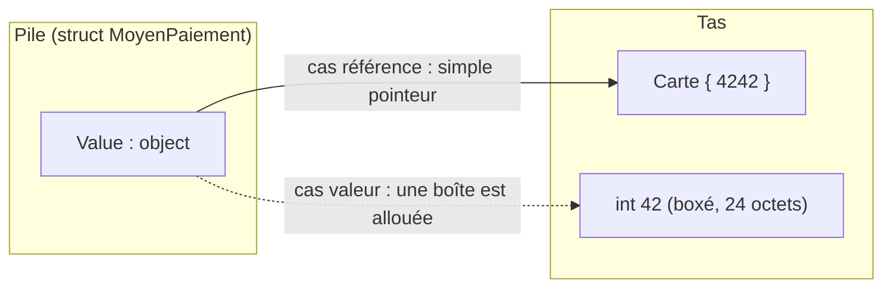

# 01 · Unions (C# 15)

> **En une phrase** : `union MoyenPaiement(Carte, Virement, BonAchat);` déclare une valeur qui est **exactement
> l'un** de ces trois types, et le compilateur vérifie que chaque `switch` les traite tous.
>
> Code : [`E01_Unions.cs`](../src/NouveautesDotNet11.Exemples/Exemples/E01_Unions.cs) ·
> Lancer : `dotnet run -c Release --project src/NouveautesDotNet11.Exemples -- unions`

---

## 1. L'idée expliquée simplement

### L'image du guichet de paiement

À la caisse, un client paie **soit** par carte, **soit** par virement, **soit** avec un bon d'achat. Jamais deux à la
fois, jamais « autre chose ». Le caissier a une fiche réflexe avec trois cases, et il sait qu'elle est complète.

En C#, ces trois moyens de paiement sont souvent **trois types sans rapport entre eux** : une `Carte` vient du module
bancaire, un `BonAchat` du module marketing. Ils n'ont pas de classe de base commune, et on ne veut pas leur en
inventer une juste pour pouvoir les ranger dans la même variable.

Une **union** dit au compilateur : « cette variable contient l'un de ces types, et rien d'autre ». Il peut alors
vérifier la fiche réflexe à votre place : si un `switch` oublie le bon d'achat, ça ne compile pas.

### Ce que les autres langages appellent ainsi

| Langage | Nom | Exemple |
|---|---|---|
| F# | *discriminated union* | `type Paiement = Carte of string \| Virement of string` |
| TypeScript | *union type* | `type Paiement = Carte \| Virement \| BonAchat` |
| Rust | `enum` avec données | `enum Paiement { Carte(String), Virement(String) }` |
| **C# 15** | **`union`** | `union MoyenPaiement(Carte, Virement, BonAchat);` |

La variante C# ressemble le plus à TypeScript : elle **regroupe des types existants**, au lieu de déclarer de
nouveaux cas.

---

## 2. Comment on faisait avant

Trois solutions courantes, toutes imparfaites :

| Solution | Problème |
|---|---|
| `object` + `switch` | Aucune garantie : on peut y ranger n'importe quoi. Un `_ => throw` obligatoire. |
| Classe de base abstraite commune | Impossible si on ne possède pas les types (`int`, `Guid`, un type d'une autre bibliothèque). |
| Bibliothèque `OneOf<T1, T2, T3>` | Paquet tiers, méthode `.Match(…)` à lambdas, types génériques illisibles dans les signatures. |

La version « maison » typique, écrite à la main :

```csharp
public sealed class MoyenPaiementAvant
{
    private readonly object _valeur;
    private MoyenPaiementAvant(object valeur) => _valeur = valeur;

    public static implicit operator MoyenPaiementAvant(Carte c) => new(c);
    public static implicit operator MoyenPaiementAvant(Virement v) => new(v);
    public static implicit operator MoyenPaiementAvant(BonAchat b) => new(b);

    public T Selon<T>(Func<Carte, T> carte, Func<Virement, T> virement, Func<BonAchat, T> bon) => _valeur switch
    {
        Carte c => carte(c),
        Virement v => virement(v),
        BonAchat b => bon(b),
        _ => throw new InvalidOperationException("Cas impossible… jusqu'au jour où quelqu'un ajoute un type."),
    };
}
```

18 lignes de plomberie, et le dernier bras `_ => throw` montre bien le problème : **le compilateur ne sait pas** que
la liste est complète.

---

## 3. Ce que change C# 15

```csharp
public union MoyenPaiement(Carte, Virement, BonAchat);

static string Decrire(MoyenPaiement moyen) => moyen switch
{
    Carte c    => $"carte se terminant par {c.Derniers4Chiffres}",
    Virement v => $"virement depuis {v.Iban[..4]}…",
    BonAchat b => $"bon d'achat {b.Code} ({b.Solde} €)",
};                                      // ← pas de « _ => » : le compilateur sait que c'est complet
```

- **Conversion implicite** depuis chaque type : `MoyenPaiement m = new Carte("4242");`
- **`switch` exhaustif** : si on ajoute `Cheque` à l'union, chaque `switch` qui l'oublie déclenche **CS8509**.
- **Types qu'on ne possède pas** : `union IdentifiantClient(int, Guid, string);` fonctionne.

### Ce que le compilateur génère vraiment

L'exemple l'inspecte par réflexion :

```
MoyenPaiement est un struct qui implémente IUnion
Constructeurs : Carte, Virement, BonAchat
Attributs : UnionAttribute
✓ une union est un struct (pas d'allocation pour l'enveloppe elle-même)
✓ le cas actif est rangé dans une propriété Value de type object
```

Autrement dit, `union MoyenPaiement(Carte, Virement, BonAchat)` devient à peu près :

```csharp
[Union]
public struct MoyenPaiement : IUnion
{
    public MoyenPaiement(Carte value)    => Value = value;
    public MoyenPaiement(Virement value) => Value = value;
    public MoyenPaiement(BonAchat value) => Value = value;
    public object? Value { get; }        // le cas actif
}
```



### Côte à côte

<table>
<tr><th>Avant : enveloppe maison</th><th>C# 15 : union</th></tr>
<tr><td valign="top">

```csharp
public sealed class MoyenPaiementAvant
{
  private readonly object _valeur;
  // + constructeur privé
  // + 3 opérateurs implicites
  // + méthode Selon(…) à 3 lambdas
  // + bras _ => throw
}

string s = moyen.Selon(
  carte: c => …,
  virement: v => …,
  bon: b => …);
```

</td><td valign="top">

```csharp
public union MoyenPaiement(
  Carte, Virement, BonAchat);


string s = moyen switch
{
  Carte c => …,
  Virement v => …,
  BonAchat b => …,
};
```

</td></tr>
<tr><td>

**~18 lignes · une classe (allocation à chaque valeur)**<br>
Oubli d'un cas : découvert **à l'exécution**.

</td><td>

**1 ligne · un struct**<br>
Oubli d'un cas : **CS8509 à la compilation**.

</td></tr>
</table>

---

## 4. Résultats de l'exemple

```
── 01 · Unions (C# 15) ──────────────────────────────────────
   ▸ Après : public union MoyenPaiement(Carte, Virement, BonAchat);
     carte se terminant par 4242
     virement depuis FR76…
     bon d'achat NOEL26 (25 €)

   ▸ Une union de types qu'on ne possède pas : int, Guid, string
     1234                                   → C-001234
     3f2504e0-4f89-11d3-9a0c-0305e82c3301   → G-3f2504e0
     vip-dupont                             → VIP-DUPONT

   ▸ Le coût caché : un type valeur est « boxé » dans Value
     IdentifiantClient id = 42;     → 24 octets alloués (l'int est boxé)
     IdentifiantClient id = "vip"; → 0 octet alloué (une référence est juste recopiée)
     ✓ int boxé = 24 octets, string = 0 octet
```

### Benchmarks (BenchmarkDotNet, 1 000 valeurs)

| Scénario | Temps | Mémoire |
|---|---:|---:|
| Avant : `object[]` + `switch` avec bras `_ => throw` | 1,79 µs | 0 |
| Après : `MoyenPaiement[]` (union de classes) + `switch` exhaustif | **1,78 µs** | **0** |
| Un `int` traité directement | 0,21 µs | 0 |
| Le même `int` rangé dans `IdentifiantClient` puis `switch` | 1,35 µs (×6,4) | 24 000 o |

- **Une union de classes ne coûte rien de plus qu'un `object`** : même temps, aucune allocation. Le `switch` produit
  la même suite de tests de type ; la seule différence est la vérification à la compilation.
- **Une union qui contient un type valeur alloue une boîte à chaque affectation** (24 octets pour un `int`).

Classes `UnionsBenchmarks` et `UnionsBoxingBenchmarks`, voir aussi le [README](../README.md#4-résultats-mesurés).

---

## 5. Pièges et limites

1. **Un `int`, un `Guid`, un `DateTime` dans une union sont boxés** (24 octets pour un `int`, 32 pour un `Guid`).
   Pour des unions de classes ou de records, aucun surcoût : l'enveloppe est un struct qui ne contient qu'une
   référence. Sur un chemin très chaud avec des types valeur, mesurez.
2. **`default(MoyenPaiement)` n'a aucun cas actif** : `Value` vaut `null`, et un `switch` lève
   `SwitchExpressionException`. Le compilateur prévient (CS8655, « le modèle 'null' n'est pas couvert ») quand il ne
   peut pas prouver que la valeur a été initialisée. Un champ non initialisé ou un tableau `new MoyenPaiement[10]`
   contiennent ce cas vide.
3. **CS8509 n'est qu'un avertissement par défaut.** Pour que l'oubli d'un cas bloque vraiment la compilation, ce
   dépôt le passe en erreur dans `Directory.Build.props` :
   ```xml
   <WarningsAsErrors>$(WarningsAsErrors);CS8509</WarningsAsErrors>
   ```
4. **Union ou hiérarchie fermée ?** Si vous possédez les types et qu'ils partagent un sens commun (les états d'une
   commande), préférez une [hiérarchie fermée](02-hierarchies-fermees.md). L'union sert à regrouper des types
   **existants et indépendants**.
5. **Sérialisation JSON** : prise en charge par System.Text.Json en .NET 11, avec un piège quand deux cas ont la même
   forme JSON (`Guid` et `string` sont tous deux des chaînes). Voir [l'exemple 10](10-json-unions.md).

## Sources

- [What's new in C# 15 — Union types](https://learn.microsoft.com/dotnet/csharp/whats-new/csharp-15)
- [C# 15 union types (blog .NET)](https://devblogs.microsoft.com/dotnet/csharp-15-union-types/)
