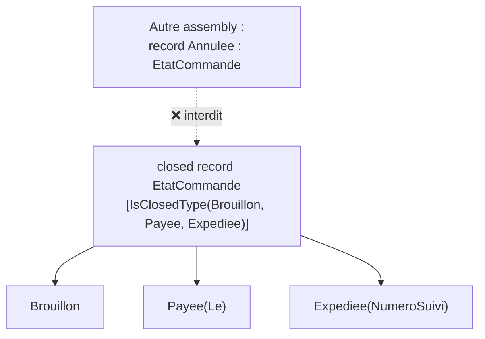

# 02 · Hiérarchies fermées (C# 15)

> **En une phrase** : `public closed record EtatCommande;` interdit toute classe dérivée en dehors de l'assembly, ce
> qui permet au compilateur de savoir qu'un `switch` sur les trois états connus est **complet**.
>
> Code : [`E02_HierarchiesFermees.cs`](../src/NouveautesDotNet11.Exemples/Exemples/E02_HierarchiesFermees.cs) ·
> Lancer : `dotnet run -c Release --project src/NouveautesDotNet11.Exemples -- fermees`

---

## 1. L'idée expliquée simplement

### L'image du feu tricolore

Un feu a trois couleurs. Si un fabricant vous livrait un jour un feu « violet », tout le code de circulation serait
faux. Le code qui gère un feu **compte sur le fait que la liste est fermée**.

En C#, une classe `abstract` est au contraire **ouverte** : n'importe quel autre projet peut en dériver. Le
compilateur ne peut donc jamais affirmer qu'un `switch` sur ses dérivées est complet, et il exige un bras
« par défaut » qui, en pratique, ne sert qu'à lever une exception.

`closed` ferme la liste : **seul l'assembly qui déclare la classe** peut en dériver directement.

### Union ou hiérarchie fermée ?

| | [Union](01-unions.md) | Hiérarchie fermée |
|---|---|---|
| Les cas sont… | des types existants, sans lien | des classes qui dérivent d'une base commune |
| On possède les types ? | pas forcément (`int`, `Guid`…) | oui, dans le même assembly |
| Membres communs | non | oui (propriétés et méthodes de la base) |
| Représentation | struct qui enveloppe un `object` | classes normales, aucune enveloppe |
| Exemple typique | `Carte \| Virement \| BonAchat` | `Brouillon`, `Payee`, `Expediee` d'une commande |

---

## 2. Comment on faisait avant

```csharp
public abstract record EtatCommandeAvant;
public record BrouillonAvant : EtatCommandeAvant;
public record PayeeAvant(DateOnly Le) : EtatCommandeAvant;
public record ExpedieeAvant(string NumeroSuivi) : EtatCommandeAvant;

static string LibelleAvant(EtatCommandeAvant etat) => etat switch
{
    BrouillonAvant => "brouillon",
    PayeeAvant p => $"payée le {p.Le:dd/MM}",
    ExpedieeAvant e => $"expédiée ({e.NumeroSuivi})",
    _ => throw new UnreachableException($"État inconnu : {etat.GetType().Name}"),   // obligatoire
};
```

Le dernier bras est le symptôme. Le jour où quelqu'un ajoute `LivreeAvant`, **rien ne casse à la compilation** :
le premier client dont la commande est livrée déclenche `UnreachableException` en production.

---

## 3. Ce que change C# 15

```csharp
public closed record EtatCommande;                  // ← un seul mot ajouté
public record Brouillon : EtatCommande;
public record Payee(DateOnly Le) : EtatCommande;
public record Expediee(string NumeroSuivi) : EtatCommande;

static string Libelle(EtatCommande etat) => etat switch
{
    Brouillon => "brouillon",
    Payee p => $"payée le {p.Le:dd/MM}",
    Expediee e => $"expédiée ({e.NumeroSuivi})",
};                                                  // ← complet : aucun bras par défaut
```

Ajouter `public record Livree : EtatCommande;` fait maintenant échouer **chaque** `switch` qui l'oublie :

```
error CS8509: L'expression switch ne prend pas en charge toutes les valeurs possibles de son type d'entrée
(elle n'est pas exhaustive). Par exemple, le modèle 'Livree' n'est pas couvert.
```

(CS8509 est un avertissement par défaut ; ce dépôt le passe en erreur dans `Directory.Build.props`.)

### Ce que le compilateur génère vraiment

```
[IsClosedType(DerivedTypes = Brouillon, Payee, Expediee)]
✓ une classe closed est implicitement abstraite (new EtatCommande() est interdit)
✓ la liste des dérivées directes est inscrite dans l'assembly
```

La liste des dérivées est **écrite dans les métadonnées** : un autre assembly qui consomme `EtatCommande` connaît
lui aussi la liste complète, et ses propres `switch` sont vérifiés.



### Côte à côte

<table>
<tr><th>Avant : abstract</th><th>C# 15 : closed</th></tr>
<tr><td valign="top">

```csharp
public abstract record Etat;

etat switch
{
  Brouillon => …,
  Payee p => …,
  Expediee e => …,
  _ => throw new
    UnreachableException(),
};
```

</td><td valign="top">

```csharp
public closed record Etat;

etat switch
{
  Brouillon => …,
  Payee p => …,
  Expediee e => …,
};


```

</td></tr>
<tr><td>

Nouvel état oublié : **exception en production**.

</td><td>

Nouvel état oublié : **erreur de compilation**, à chaque endroit concerné.

</td></tr>
</table>

---

## 4. Résultats de l'exemple

```
── 02 · Hiérarchies fermées (C# 15) ─────────────────────────
   ▸ Après : public closed record EtatCommande;
     brouillon                annulable : oui
     payée le 10/11           annulable : oui
     expédiée (COLIS-42)      annulable : non
```

Aucun coût à l'exécution : ce sont des classes ordinaires, le `switch` produit exactement le même code machine
qu'avant (une série de tests de type). Seul le bras `_ => throw` disparaît.

---

## 5. Pièges et limites

1. **`closed` implique `abstract`** : on ne peut ni l'instancier, ni le combiner avec `sealed`, `static` ou un
   `abstract` explicite.
2. **Seules les dérivées *directes* sont contrôlées.** Si `Payee` a elle-même des dérivées (`PayeeParCarte`,
   `PayeeParVirement`), marquez `Payee` aussi `closed` pour que le compilateur connaisse toute l'arborescence.
3. **La fermeture vaut pour l'assembly**, pas pour le fichier : un collègue peut ajouter une dérivée ailleurs dans le
   même projet. C'est voulu, et c'est justement CS8509 qui lui montrera tous les `switch` à compléter.
4. **`null` reste possible** pour une variable de type référence nullable : `EtatCommande? e` demande un bras `null`.
5. **JSON** : System.Text.Json peut déduire le polymorphisme d'une hiérarchie fermée sans liste de
   `[JsonDerivedType]` (voir [l'exemple 10](10-json-unions.md)).

## Sources

- [What's new in C# 15 — Closed hierarchies](https://learn.microsoft.com/dotnet/csharp/whats-new/csharp-15)
