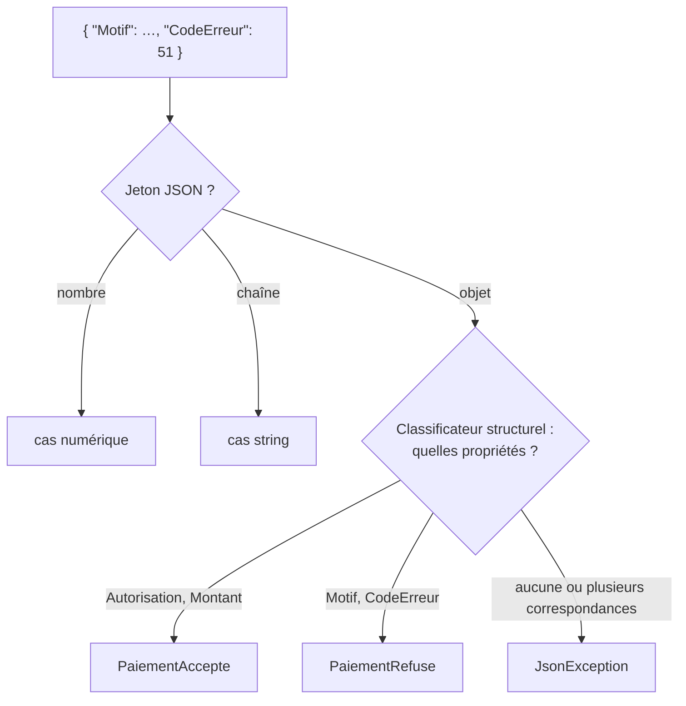

# 10 · System.Text.Json : unions, hiérarchies fermées, nommage par type (.NET 11)

> **En une phrase** : System.Text.Json sait sérialiser les [unions](01-unions.md) de C# 15, deviner le cas d'un objet
> JSON d'après ses propriétés, déduire le polymorphisme d'une [hiérarchie fermée](02-hierarchies-fermees.md), et
> appliquer une politique de nommage à un seul type.
>
> Code : [`E10_JsonUnions.cs`](../src/NouveautesDotNet11.Exemples/Exemples/E10_JsonUnions.cs) ·
> Lancer : `dotnet run -c Release --project src/NouveautesDotNet11.Exemples -- json`

---

## 1. L'idée expliquée simplement

Un prestataire de paiement vous répond **soit** `{"Autorisation":"A1B2C3","Montant":42.5}`, **soit**
`{"Motif":"Fonds insuffisants","CodeErreur":51}`. Il n'y a **pas de champ « type »** : c'est la forme de l'objet
qui dit ce que c'est. C'est très courant dans les API qu'on ne maîtrise pas.

Pour désérialiser ça, il faut **regarder les propriétés présentes** avant de choisir la classe. Jusqu'ici,
System.Text.Json ne savait faire du polymorphisme qu'avec un discriminant explicite (`"$type": "…"`).

.NET 11 apporte :

| Besoin | Avant | .NET 11 |
|---|---|---|
| Choisir le type d'après la forme du JSON | `JsonConverter` maison | `union` + `JsonUnionTypeStructuralClassifier` |
| Union de valeurs simples (`double` ou `string`) | `JsonConverter` maison | `union Mesure(double, string)`, rien à configurer |
| Polymorphisme d'une hiérarchie | un `[JsonDerivedType]` par classe | `closed` + `InferClosedTypePolymorphism = true` |
| snake_case pour un seul type | un `[JsonPropertyName]` par propriété | `[JsonNamingPolicy(SnakeCaseLower)]` sur le type |
| PascalCase global | politique maison | `JsonNamingPolicy.PascalCase` |

---

## 2. Comment on faisait avant

```csharp
public sealed class ReponsePaiementConvertisseurAvant : JsonConverter<object>
{
    public override object Read(ref Utf8JsonReader lecteur, Type type, JsonSerializerOptions options)
    {
        using var doc = JsonDocument.ParseValue(ref lecteur);                  // lit tout l'objet en mémoire
        if (doc.RootElement.TryGetProperty("Autorisation", out _)) return doc.RootElement.Deserialize<PaiementAccepte>(options)!;
        if (doc.RootElement.TryGetProperty("Motif", out _)) return doc.RootElement.Deserialize<PaiementRefuse>(options)!;
        throw new JsonException("Réponse de paiement inconnue");
    }

    public override void Write(Utf8JsonWriter ecrivain, object valeur, JsonSerializerOptions options) =>
        JsonSerializer.Serialize(ecrivain, valeur, valeur.GetType(), options);
}
```

Et pour une hiérarchie, la liste à tenir à jour :

```csharp
[JsonPolymorphic]
[JsonDerivedType(typeof(RemisePourcentageAvant), "RemisePourcentageAvant")]
[JsonDerivedType(typeof(RemiseMontantAvant), "RemiseMontantAvant")]      // oublier une ligne = exception à l'exécution
public abstract record RemiseAvant;
```

---

## 3. Ce que change .NET 11

```csharp
[JsonUnion(TypeClassifier = typeof(JsonUnionTypeStructuralClassifier))]
public union ReponsePaiement(PaiementAccepte, PaiementRefuse);

ReponsePaiement r = JsonSerializer.Deserialize<ReponsePaiement>(json);
string texte = r switch
{
    PaiementAccepte a => $"accepté, autorisation {a.Autorisation}",
    PaiementRefuse r  => $"refusé ({r.CodeErreur}) : {r.Motif}",
};
```

Le **classificateur structurel** compare les noms de propriétés présents dans l'objet JSON avec ceux de chaque cas.
Zéro ou plusieurs correspondances : `JsonException`.



```csharp
[JsonPolymorphic(InferClosedTypePolymorphism = true)]
public closed record Remise;                 // les dérivées sont trouvées dans les métadonnées de « closed »
public record RemisePourcentage(int Pourcentage) : Remise;
public record RemiseMontant(decimal Montant) : Remise;

[JsonNamingPolicy(JsonKnownNamingPolicy.SnakeCaseLower)]
public record Webhook(string EventId, DateTimeOffset CreatedAt, long AmountCents);
```

---

## 4. Résultats de l'exemple

```
   ▸ Union de valeurs simples : écrite telle quelle, sans enveloppe ni $type
     [21.5,"capteur hors ligne"]
   ▸ Après : [JsonUnion(TypeClassifier = typeof(JsonUnionTypeStructuralClassifier))]
     {"Autorisation":"A1B2C3","Montant":42.5}                → accepté, autorisation A1B2C3 pour 42,5 €
     {"Motif":"Fonds insuffisants","CodeErreur":51}          → refusé (51) : Fonds insuffisants
     ✓ le cas est choisi d'après les noms de propriétés présents
     ✓ un objet qui ne correspond à aucun cas lève JsonException
   ▸ Hiérarchie fermée : InferClosedTypePolymorphism remplace la liste des [JsonDerivedType]
     avant : [{"$type":"RemisePourcentageAvant","Pourcentage":10},{"$type":"RemiseMontantAvant","Montant":5}]
     après : [{"$type":"RemisePourcentage","Pourcentage":10},{"$type":"RemiseMontant","Montant":5}]
   ▸ Politique de nommage au niveau du type : [JsonNamingPolicy(SnakeCaseLower)]
     avant (3 attributs) : {"event_id":"evt_42","created_at":"2026-11-10T09:00:00+00:00","amount_cents":4250}
     après (1 attribut)  : {"event_id":"evt_42","created_at":"2026-11-10T09:00:00+00:00","amount_cents":4250}
   ▸ Et la nouvelle politique globale JsonNamingPolicy.PascalCase
     {"NumeroCommande":"C-001","MontantTtc":42.5}
```

Le polymorphisme déduit utilise **le nom de la classe** comme discriminant (`"$type":"RemisePourcentage"`).

---

## 5. Pièges et limites

1. **Deux cas de même forme JSON sont ambigus.** `union IdentifiantClient(int, Guid, string)` se sérialise bien, mais
   se **désérialise** mal : un `Guid` et un `string` sont tous deux des chaînes JSON. Erreur obtenue en le testant :
   ```
   JsonException: JSON value type 'String' is ambiguous for union type 'IdentifiantClient' because multiple case
   types can use this value type. Specify a custom type classifier to support deserialization.
   ```
   Solution : un classificateur maison (`JsonTypeClassifierFactory`), ou éviter ce mélange dans une union destinée au JSON.
2. **Le classificateur structurel** ne gère pas les unions imbriquées, les cas eux-mêmes polymorphes, ni
   `ReferenceHandler.Preserve`.
3. **Renommer une classe change le JSON** quand le discriminant est déduit (`$type` = nom de la classe). Pour un
   contrat public stable, gardez des `[JsonDerivedType(typeof(X), "nom-stable")]` explicites : ils remplacent la liste
   déduite.
4. **Priorité des règles de nommage** : `[JsonPropertyName]` > `[JsonNamingPolicy]` sur la propriété >
   `[JsonNamingPolicy]` sur le type > `JsonSerializerOptions.PropertyNamingPolicy` > nom C#.
5. **Applications en un fichier et Native AOT** : la sérialisation par réflexion y est désactivée par défaut ; il faut
   un `JsonSerializerContext` (générateur de source) ou `#:property PublishAot=false`.

## Sources

- [What's new in .NET 11 libraries — System.Text.Json](https://learn.microsoft.com/dotnet/core/whats-new/dotnet-11/libraries)
