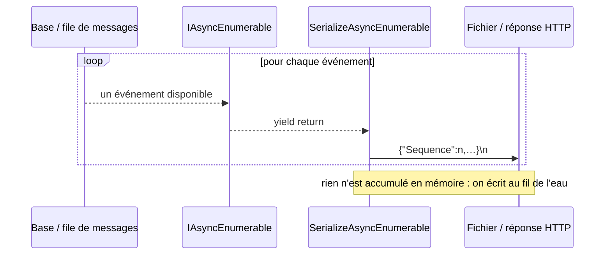

# 11 · JSON Lines : `JsonSerializer.SerializeAsyncEnumerable` (.NET 11)

> **En une phrase** : `await JsonSerializer.SerializeAsyncEnumerable(flux, source, topLevelValues: true)` écrit un
> flux asynchrone au format JSON Lines (un objet par ligne), au fil de l'eau.
>
> Code : [`E11_JsonLines.cs`](../src/NouveautesDotNet11.Exemples/Exemples/E11_JsonLines.cs) ·
> Lancer : `dotnet run -c Release --project src/NouveautesDotNet11.Exemples -- jsonl`

---

## 1. L'idée expliquée simplement

### Un tableau ou des lignes ?

Pour envoyer 10 000 événements, on peut écrire **un seul tableau JSON** :

```json
[{"Sequence":1,…},{"Sequence":2,…}, … ,{"Sequence":10000,…}]
```

ou **une valeur par ligne**, le format **JSON Lines** (`.jsonl`, aussi appelé NDJSON) :

```
{"Sequence":1,"Type":"payee","Commande":"CMD-0001"}
{"Sequence":2,"Type":"expediee","Commande":"CMD-0001"}
{"Sequence":3,"Type":"creee","Commande":"CMD-0002"}
```

JSON Lines a de gros avantages :

- **on peut ajouter** à la fin d'un fichier sans le relire (journaux, audit) ;
- **une ligne abîmée n'abîme pas les autres** ;
- les outils en ligne de commande (`grep`, `head`, `wc -l`) fonctionnent ligne à ligne ;
- c'est le format d'entrée de nombreux services : imports en masse Elasticsearch/OpenSearch, BigQuery, jeux de
  données d'entraînement d'IA, réponses en flux de certaines API.

### Et « asynchrone » ?

`IAsyncEnumerable<T>` est une source qui produit ses éléments **au fil du temps** (lecture de base de données,
file de messages). `SerializeAsyncEnumerable` écrit chaque élément **dès qu'il arrive**, sans attendre la fin ni
tout garder en mémoire.

---

## 2. Comment on faisait avant

.NET 9 savait déjà **lire** du JSON Lines (`DeserializeAsyncEnumerable(flux, topLevelValues: true)`), mais pas
l'**écrire**. On écrivait la boucle soi-même :

```csharp
byte[] sautDeLigne = "\n"u8.ToArray();
await foreach (var evenement in source)
{
    await JsonSerializer.SerializeAsync(sortie, evenement);   // attention : jamais WriteIndented ici
    await sortie.WriteAsync(sautDeLigne);
}
```

Trois pièges : oublier que `WriteIndented = true` casse le format (un objet sur plusieurs lignes), écrire `\r\n`
sous Windows avec `WriteLine`, et recréer un écrivain JSON à chaque élément.

---

## 3. Ce que change .NET 11

```csharp
await JsonSerializer.SerializeAsyncEnumerable(sortie, Evenements(), topLevelValues: true);   // JSON Lines
await JsonSerializer.SerializeAsyncEnumerable(sortie, Evenements());                         // un tableau [ … ]
```

Quatre surcharges : vers un `Stream` ou un `PipeWriter`, avec des `JsonSerializerOptions` ou un `JsonTypeInfo<T>`
(générateur de source, compatible Native AOT).



### Côte à côte

<table>
<tr><th>Avant</th><th>.NET 11</th></tr>
<tr><td valign="top">

```csharp
var nl = "\n"u8.ToArray();
await foreach (var e in source)
{
  await JsonSerializer
    .SerializeAsync(sortie, e);
  await sortie.WriteAsync(nl);
}
```

</td><td valign="top">

```csharp
await JsonSerializer
  .SerializeAsyncEnumerable(
    sortie, source,
    topLevelValues: true);


```

</td></tr>
</table>

---

## 4. Résultats

### Sortie de l'exemple

```
   ▸ Après : SerializeAsyncEnumerable(flux, source, topLevelValues: true)
     {"Sequence":1,"Type":"payee","Commande":"CMD-0001"}
     {"Sequence":2,"Type":"expediee","Commande":"CMD-0001"}
     {"Sequence":3,"Type":"creee","Commande":"CMD-0002"}
     ✓ octet pour octet le même résultat que la boucle manuelle
     ✓ chaque ligne, y compris la dernière, se termine par \n (jamais \r\n, même sous Windows)
   ▸ Les options d'indentation sont ignorées : une valeur = une ligne, toujours
     ✓ WriteIndented = true ne casse pas le format (2 objets = 2 lignes)
   ▸ Aller-retour : DeserializeAsyncEnumerable(…, topLevelValues: true) relit le fichier
     545 Ko écrits, 10000 événements relus, dernier n° 10000
```

### Benchmark : écrire 10 000 événements

| Méthode | Temps | Mémoire |
|---|---:|---:|
| Avant : boucle `SerializeAsync` + `\n` | 1,48 ms | 4,21 Mo |
| **Après : `SerializeAsyncEnumerable(…, topLevelValues: true)`** | **1,22 ms (−18 %)** | **2,38 Mo (−43 %)** |

Le gain vient de la réutilisation d'un seul écrivain JSON et de ses tampons pour tout le flux, au lieu d'un par élément.

---

## 5. Pièges et limites

1. **Toujours `\n`**, jamais `\r\n`, quel que soit `JsonSerializerOptions.NewLine` : c'est ce qu'exige le format.
2. **`WriteIndented` est ignoré** en mode `topLevelValues: true`. En mode tableau, il s'applique normalement.
3. **Pour une réponse HTTP** en ASP.NET Core, utilisez la surcharge `PipeWriter` avec `Response.BodyWriter` et le type
   de contenu `application/jsonl` (ou `application/x-ndjson` selon le client).

## Sources

- [What's new in .NET 11 libraries — System.Text.Json](https://learn.microsoft.com/dotnet/core/whats-new/dotnet-11/libraries)
- [JSON Lines](https://jsonlines.org/)
