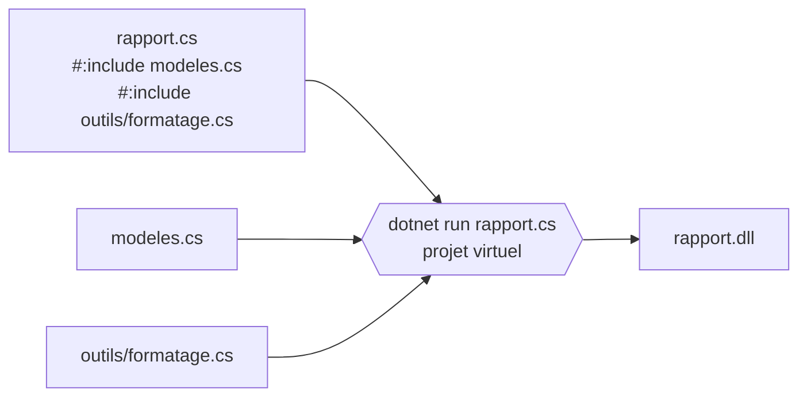

# 16 · Applications en un fichier : `#:include` (SDK .NET 11)

> **En une phrase** : une application C# sans `.csproj` (`dotnet run rapport.cs`, apparue en .NET 10) peut maintenant
> **inclure d'autres fichiers** avec `#:include modeles.cs`.
>
> Code : [`appli-fichier/rapport.cs`](../appli-fichier/rapport.cs),
> [`modeles.cs`](../appli-fichier/modeles.cs), [`outils/formatage.cs`](../appli-fichier/outils/formatage.cs) ·
> Lancer : `dotnet run appli-fichier/rapport.cs -- Lyon`

---

## 1. L'idée expliquée simplement

.NET 10 a introduit les **applications en un fichier** : un simple `script.cs`, lancé par `dotnet run script.cs`,
sans projet ni solution. Les réglages qui allaient dans le `.csproj` passent dans des **directives** en tête de
fichier :

```csharp
#:package Humanizer@2.14.1          // une dépendance NuGet
#:property LangVersion=preview      // une propriété MSBuild
#:sdk Microsoft.NET.Sdk.Web         // un autre SDK
```

Idéal pour des outils, des scripts d'administration, des prototypes. Mais **un seul fichier** : dès que le script
grossit, on voudrait sortir les modèles ou les utilitaires dans des fichiers à part, ou les **partager entre
plusieurs scripts**. En .NET 10, la seule issue était de convertir en projet (`dotnet project convert`).

---

## 2. Ce que change le SDK .NET 11

```csharp
#!/usr/bin/env dotnet
#:include modeles.cs
#:include outils/formatage.cs
#:property Company="Boutique Café & Thé"
#:property PublishAot=false
```

| Directive | Nouveauté .NET 11 |
|---|---|
| `#:include fichier.cs` | inclut un fichier C# (chemin relatif, sous-dossiers compris) |
| `#:include ./libs/MaBibli.dll` | référence une DLL |
| `#:property Nom="valeur avec espaces"` | valeurs entre guillemets |
| `#:package Paquet@1.0 Aliases=Alias` | métadonnées sur une référence de paquet |
| Directives répétées | autorisées si les valeurs sont identiques (utile quand deux fichiers inclus déclarent le même paquet) |

Et autour : `dotnet format app.cs`, `dotnet reference add --file app.cs <projet>`, `dotnet run -e CLE=VALEUR`.



---

## 3. Côte à côte

<table>
<tr><th>.NET 10 : tout dans un fichier</th><th>.NET 11 : #:include</th></tr>
<tr><td valign="top">

```csharp
// rapport.cs, 120 lignes :
// le code du rapport
// + les records
// + les données d'exemple
// + les utilitaires de formatage
// (copiés dans chaque script
//  qui en a besoin)
```

</td><td valign="top">

```csharp
// rapport.cs, 25 lignes
#:include modeles.cs
#:include outils/formatage.cs

// modeles.cs, outils/formatage.cs :
// partagés par plusieurs scripts

```

</td></tr>
</table>

---

## 4. Résultats

```
> dotnet run appli-fichier/rapport.cs
Rapport toutes villes — Boutique Café & Thé
  Lyon         2 commande(s)       49,50 €
  Nantes       1 commande(s)       99,00 €
  Paris        2 commande(s)       84,20 €
  Total        5 commande(s)      232,70 €

> dotnet run appli-fichier/rapport.cs -- Lyon
Rapport Lyon — Boutique Café & Thé
  Lyon         2 commande(s)       49,50 €
  Total        2 commande(s)       49,50 €
```

La propriété `#:property Company="Boutique Café & Thé"` (valeur entre guillemets, avec espaces et `&`) arrive bien
dans l'attribut `AssemblyCompany` lu par le programme.

---

## 5. Pièges et limites

1. **Commencez le fichier principal par `#!`** : sans ligne *shebang*, l'analyseur CA2266 avertit (« Le point
   d'entrée du programme basé sur fichier doit commencer par #! »). Rencontré en écrivant l'exemple. La ligne
   `#!/usr/bin/env dotnet` permet aussi de lancer le script directement sous Linux et macOS (`chmod +x`).
2. **Native AOT est activé par défaut** pour une application en un fichier : la sérialisation JSON par réflexion y est
   désactivée. D'où `#:property PublishAot=false` ici (ou un `JsonSerializerContext`).
3. **`Directory.Build.props` s'applique** aux applications en un fichier comme aux projets : celle-ci hérite du
   `net11.0` du dépôt.
4. **Un nom de propriété ne peut pas contenir `:`** dans `#:property`.

## Sources

- [What's new in the .NET 11 SDK — File-based apps](https://learn.microsoft.com/dotnet/core/whats-new/dotnet-11/sdk)
