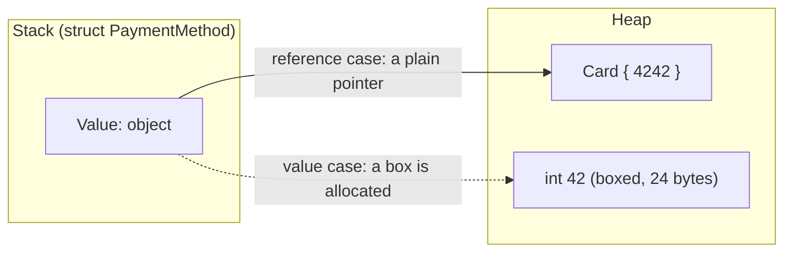

# 01 · Unions (C# 15)

🇫🇷 [Version française](../fr/01-unions.md)

> **In one sentence**: `union PaymentMethod(Card, BankTransfer, Voucher);` declares a value that is **exactly one**
> of these three types, and the compiler checks that every `switch` handles all of them.
>
> Code: [`E01_Unions.cs`](../../src/DotNet11Features.Examples/Examples/E01_Unions.cs) ·
> Run: `dotnet run -c Release --project src/DotNet11Features.Examples -- unions`

---

## 1. The idea, simply

### The checkout counter

At the checkout, a customer pays **either** by card, **or** by bank transfer, **or** with a voucher. Never two at
once, never "something else". The cashier has a checklist with three boxes, and knows it is complete.

In C#, these three payment methods are often **three unrelated types**: a `Card` comes from the banking module, a
`Voucher` from the marketing module. They have no common base class, and we do not want to invent one just to store
them in the same variable.

A **union** tells the compiler: "this variable holds one of these types, and nothing else". It can then check the
checklist for you: if a `switch` forgets the voucher, it does not compile.

### What other languages call it

| Language | Name | Example |
|---|---|---|
| F# | *discriminated union* | `type Payment = Card of string \| Transfer of string` |
| TypeScript | *union type* | `type Payment = Card \| BankTransfer \| Voucher` |
| Rust | `enum` with data | `enum Payment { Card(String), Transfer(String) }` |
| **C# 15** | **`union`** | `union PaymentMethod(Card, BankTransfer, Voucher);` |

The C# flavor is closest to TypeScript: it **groups existing types**, instead of declaring new cases.

---

## 2. How we did it before

Three common solutions, all imperfect:

| Solution | Problem |
|---|---|
| `object` + `switch` | No guarantee: anything can go in. A `_ => throw` is mandatory. |
| Common abstract base class | Impossible when you do not own the types (`int`, `Guid`, a type from another library). |
| `OneOf<T1, T2, T3>` library | Third-party package, `.Match(…)` method with lambdas, unreadable generic types in signatures. |

The typical hand-written version:

```csharp
public sealed class PaymentMethodBefore
{
    private readonly object _value;
    private PaymentMethodBefore(object value) => _value = value;

    public static implicit operator PaymentMethodBefore(Card c) => new(c);
    public static implicit operator PaymentMethodBefore(BankTransfer t) => new(t);
    public static implicit operator PaymentMethodBefore(Voucher v) => new(v);

    public T Match<T>(Func<Card, T> card, Func<BankTransfer, T> transfer, Func<Voucher, T> voucher) => _value switch
    {
        Card c => card(c),
        BankTransfer t => transfer(t),
        Voucher v => voucher(v),
        _ => throw new InvalidOperationException("Impossible case… until someone adds a type."),
    };
}
```

18 lines of plumbing, and the last `_ => throw` arm says it all: **the compiler does not know** the list is complete.

---

## 3. What C# 15 changes

```csharp
public union PaymentMethod(Card, BankTransfer, Voucher);

static string Describe(PaymentMethod method) => method switch
{
    Card c         => $"card ending in {c.Last4Digits}",
    BankTransfer t => $"transfer from {t.Iban[..4]}…",
    Voucher v      => $"voucher {v.Code} ({v.Balance} €)",
};                                      // ← no "_ =>": the compiler knows it is complete
```

- **Implicit conversion** from each type: `PaymentMethod m = new Card("4242");`
- **Exhaustive `switch`**: add `Cheque` to the union, and every `switch` that forgets it triggers **CS8509**.
- **Types you do not own**: `union CustomerId(int, Guid, string);` works.

### What the compiler really generates

The example inspects it through reflection:

```
PaymentMethod is a struct implementing IUnion
Constructors: Card, BankTransfer, Voucher
Attributes: UnionAttribute
✓ a union is a struct (the wrapper itself is not allocated)
✓ the active case is stored in a Value property of type object
```

In other words, `union PaymentMethod(Card, BankTransfer, Voucher)` becomes roughly:

```csharp
[Union]
public struct PaymentMethod : IUnion
{
    public PaymentMethod(Card value)         => Value = value;
    public PaymentMethod(BankTransfer value) => Value = value;
    public PaymentMethod(Voucher value)      => Value = value;
    public object? Value { get; }        // the active case
}
```



### Side by side

<table>
<tr><th>Before: hand-written wrapper</th><th>C# 15: union</th></tr>
<tr><td valign="top">

```csharp
public sealed class PaymentMethodBefore
{
  private readonly object _value;
  // + private constructor
  // + 3 implicit operators
  // + Match(…) method with 3 lambdas
  // + _ => throw arm
}

string s = method.Match(
  card: c => …,
  transfer: t => …,
  voucher: v => …);
```

</td><td valign="top">

```csharp
public union PaymentMethod(
  Card, BankTransfer, Voucher);


string s = method switch
{
  Card c => …,
  BankTransfer t => …,
  Voucher v => …,
};
```

</td></tr>
<tr><td>

**~18 lines · a class (one allocation per value)**<br>
Forgotten case: found **at runtime**.

</td><td>

**1 line · a struct**<br>
Forgotten case: **CS8509 at compile time**.

</td></tr>
</table>

---

## 4. Results

### Output of the example

```
── 01 · Unions (C# 15) ──────────────────────────────────────
   ▸ After: public union PaymentMethod(Card, BankTransfer, Voucher);
     card ending in 4242
     transfer from FR76…
     voucher XMAS26 (25 €)

   ▸ A union of types you do not own: int, Guid, string
     1234                                   → C-001234
     3f2504e0-4f89-11d3-9a0c-0305e82c3301   → G-3f2504e0
     vip-smith                              → VIP-SMITH

   ▸ The hidden cost: a value type is boxed into Value
     CustomerId id = 42;    → 24 bytes allocated (the int is boxed)
     CustomerId id = "vip"; → 0 byte allocated (a reference is just copied)
     ✓ boxed int = 24 bytes, string = 0 byte
```

### Benchmarks (BenchmarkDotNet, 1,000 values)

| Scenario | Time | Memory |
|---|---:|---:|
| Before: `object[]` + `switch` with a `_ => throw` arm | 1.74 µs | 0 |
| After: `PaymentMethod[]` (union of classes) + exhaustive `switch` | 1.85 µs (+6 %) | **0** |
| An `int` handled directly | 0.21 µs | 0 |
| The same `int` stored in `CustomerId`, then `switch` | 1.27 µs (×6.1) | 24,000 B |

- **A union of classes allocates nothing** and costs about as much as an `object` (+6 % in the full BenchmarkDotNet
  job: reading `Value` through the struct adds a load; short jobs gave anywhere between −1 % and +39 %, so treat it as
  "about the same"). What you gain is the compile-time check.
- **A union holding a value type allocates a box on every assignment** (24 bytes for an `int`).

`UnionBenchmarks` and `UnionBoxingBenchmarks` classes; see also the [README](../../README.md#4-measured-results).

---

## 5. Pitfalls and limits

1. **An `int`, a `Guid` or a `DateTime` in a union are boxed** (24 bytes for an `int`, 32 for a `Guid`). For unions
   of classes or records, no allocation: the wrapper is a struct that only holds a reference. On a very hot path with
   value types, measure.
2. **`default(PaymentMethod)` has no active case**: `Value` is `null`, and a `switch` throws
   `SwitchExpressionException`. The compiler warns (CS8655, "the pattern 'null' is not covered") when it cannot prove
   the value was initialized. An uninitialized field or a `new PaymentMethod[10]` array contain this empty case.
3. **CS8509 is only a warning by default.** For a forgotten case to really break the build, this repository turns it
   into an error in `Directory.Build.props`:
   ```xml
   <WarningsAsErrors>$(WarningsAsErrors);CS8509</WarningsAsErrors>
   ```
4. **Union or closed hierarchy?** If you own the types and they share a common meaning (the states of an order),
   prefer a [closed hierarchy](02-closed-hierarchies.md). A union is for grouping **existing, independent** types.
5. **JSON serialization**: supported by System.Text.Json in .NET 11, with a trap when two cases share the same JSON
   shape (`Guid` and `string` are both strings). See [example 10](10-json-unions.md).

## Sources

- [What's new in C# 15 — Union types](https://learn.microsoft.com/dotnet/csharp/whats-new/csharp-15)
- [C# 15 union types (.NET blog)](https://devblogs.microsoft.com/dotnet/csharp-15-union-types/)
