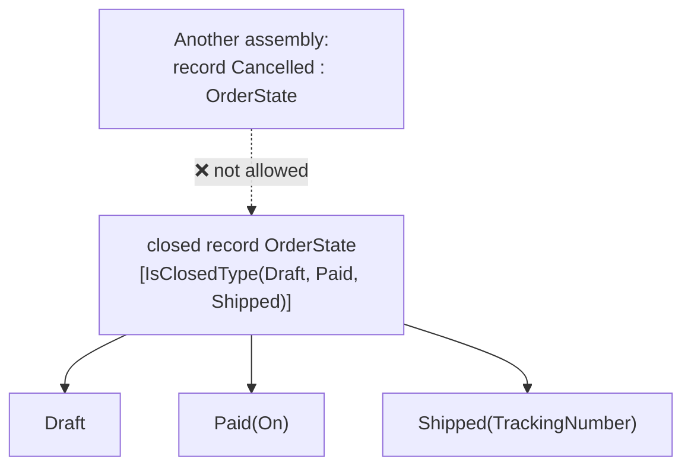

# 02 · Closed hierarchies (C# 15)

🇫🇷 [Version française](../fr/02-hierarchies-fermees.md)

> **In one sentence**: `public closed record OrderState;` forbids any derived class outside the assembly, so the
> compiler knows that a `switch` over the three known states is **complete**.
>
> Code: [`E02_ClosedHierarchies.cs`](../../src/DotNet11Features.Examples/Examples/E02_ClosedHierarchies.cs) ·
> Run: `dotnet run -c Release --project src/DotNet11Features.Examples -- closed`

---

## 1. The idea, simply

### The traffic light

A traffic light has three colors. If a manufacturer one day shipped a "purple" light, all traffic code would be
wrong. Code that handles a traffic light **relies on the list being closed**.

In C#, an `abstract` class is the opposite: **open**. Any other project can derive from it. The compiler can never
claim that a `switch` over its derived types is complete, and it requires a "default" arm that, in practice, only
throws an exception.

`closed` closes the list: **only the assembly that declares the class** can derive from it directly.

### Union or closed hierarchy?

| | [Union](01-unions.md) | Closed hierarchy |
|---|---|---|
| The cases are… | existing, unrelated types | classes deriving from a common base |
| Do you own the types? | not necessarily (`int`, `Guid`…) | yes, in the same assembly |
| Shared members | no | yes (properties and methods of the base) |
| Representation | struct wrapping an `object` | ordinary classes, no wrapper |
| Typical example | `Card \| BankTransfer \| Voucher` | `Draft`, `Paid`, `Shipped` for an order |

---

## 2. How we did it before

```csharp
public abstract record OrderStateBefore;
public record DraftBefore : OrderStateBefore;
public record PaidBefore(DateOnly On) : OrderStateBefore;
public record ShippedBefore(string TrackingNumber) : OrderStateBefore;

static string LabelBefore(OrderStateBefore state) => state switch
{
    DraftBefore => "draft",
    PaidBefore p => $"paid on {p.On:MM/dd}",
    ShippedBefore s => $"shipped ({s.TrackingNumber})",
    _ => throw new UnreachableException($"Unknown state: {state.GetType().Name}"),   // required
};
```

The last arm is the symptom. The day someone adds `DeliveredBefore`, **nothing breaks at compile time**: the first
customer whose order is delivered triggers `UnreachableException` in production.

---

## 3. What C# 15 changes

```csharp
public closed record OrderState;                    // ← one word added
public record Draft : OrderState;
public record Paid(DateOnly On) : OrderState;
public record Shipped(string TrackingNumber) : OrderState;

static string Label(OrderState state) => state switch
{
    Draft => "draft",
    Paid p => $"paid on {p.On:MM/dd}",
    Shipped s => $"shipped ({s.TrackingNumber})",
};                                                  // ← complete: no default arm
```

Adding `public record Delivered : OrderState;` now breaks **every** `switch` that forgets it (message as given by
an English-language compiler):

```
error CS8509: The switch expression does not handle all possible values of its input type (it is not
exhaustive). For example, the pattern 'Delivered' is not covered.
```

(CS8509 is a warning by default; this repository turns it into an error in `Directory.Build.props`.)

### What the compiler really generates

```
[IsClosedType(DerivedTypes = Draft, Paid, Shipped)]
✓ a closed class is implicitly abstract (new OrderState() is not allowed)
✓ the list of direct derived types is written into the assembly
```

The list of derived types is **written into the metadata**: another assembly consuming `OrderState` also knows the
complete list, and its own `switch` statements are checked.



### Side by side

<table>
<tr><th>Before: abstract</th><th>C# 15: closed</th></tr>
<tr><td valign="top">

```csharp
public abstract record State;

state switch
{
  Draft => …,
  Paid p => …,
  Shipped s => …,
  _ => throw new
    UnreachableException(),
};
```

</td><td valign="top">

```csharp
public closed record State;

state switch
{
  Draft => …,
  Paid p => …,
  Shipped s => …,
};


```

</td></tr>
<tr><td>

Forgotten new state: **exception in production**.

</td><td>

Forgotten new state: **compile error**, at every place concerned.

</td></tr>
</table>

---

## 4. Output of the example

```
── 02 · Closed hierarchies (C# 15) ──────────────────────────
   ▸ After: public closed record OrderState;
     draft                    cancellable: yes
     paid on 11/10            cancellable: yes
     shipped (PARCEL-42)      cancellable: no
```

No runtime cost: these are ordinary classes, and the `switch` produces exactly the same machine code as before (a
series of type tests). Only the `_ => throw` arm disappears.

---

## 5. Pitfalls and limits

1. **`closed` implies `abstract`**: it cannot be instantiated, nor combined with `sealed`, `static` or an explicit
   `abstract`.
2. **Only *direct* derived types are checked.** If `Paid` has derived types of its own (`PaidByCard`,
   `PaidByTransfer`), mark `Paid` as `closed` too so the compiler knows the whole tree.
3. **The closure applies to the assembly**, not to the file: a teammate can add a derived type elsewhere in the
   same project. That is intended, and CS8509 is precisely what will show them every `switch` to complete.
4. **`null` is still possible** for a nullable reference variable: `OrderState? s` needs a `null` arm.
5. **JSON**: System.Text.Json can infer the polymorphism of a closed hierarchy without a list of
   `[JsonDerivedType]` (see [example 10](10-json-unions.md)).

## Sources

- [What's new in C# 15 — Closed hierarchies](https://learn.microsoft.com/dotnet/csharp/whats-new/csharp-15)
