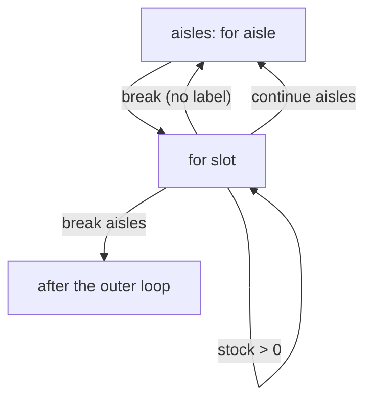

# 05 · Labeled `break` and `continue` (C# 15)

🇫🇷 [Version française](../fr/05-break-continue-etiquetes.md)

> **In one sentence**: `aisles: for (…) { for (…) { … break aisles; } }` leaves the outer loop directly, with no
> "found" variable and no `goto`.
>
> Code: [`E05_LabeledLoops.cs`](../../src/DotNet11Features.Examples/Examples/E05_LabeledLoops.cs) ·
> Run: `dotnet run -c Release --project src/DotNet11Features.Examples -- loops`

---

## 1. The idea, simply

In a warehouse of 4 aisles × 5 slots, we look for the **first empty slot**. Two nested loops: the aisles, then the
slots of each aisle.

Once found, we want to **stop everything**. But `break` only leaves the **nearest** loop: we end up back in the aisle
loop, which happily moves on to the next aisle.

C# 15 lets you **name a loop** and say which one to leave. Java, JavaScript, Kotlin, Rust, Go and Swift have done it
for a long time.

---

## 2. How we did it before

**Option 1: a flag**, tested at every level.

```csharp
bool found = false;
for (int aisle = 0; aisle < Warehouse.Length; aisle++)
{
    for (int slot = 0; slot < Warehouse[aisle].Length; slot++)
    {
        if (Warehouse[aisle][slot] == 0) { result = (aisle, slot); found = true; break; }
    }
    if (found) break;   // do not forget it, or the search goes on
}
```

**Option 2: `goto`**, direct but frowned upon (and the IDE0410 analyzer now reports this pattern).

```csharp
for (…)
    for (…)
        if (Warehouse[aisle][slot] == 0) { result = (aisle, slot); goto Done; }
Done:
```

**Option 3: extract a method** and `return`. Clean, but you split the code only to work around a language limit.

---

## 3. What C# 15 changes

```csharp
aisles: for (int aisle = 0; aisle < Warehouse.Length; aisle++)
{
    for (int slot = 0; slot < Warehouse[aisle].Length; slot++)
    {
        if (Warehouse[aisle][slot] == 0) { result = (aisle, slot); break aisles; }
    }
}
```

And labeled `continue`, to move to the next iteration of the outer loop:

```csharp
aisles: foreach (var (aisle, index) in Warehouse.Select((a, i) => (a, i)))
{
    foreach (int stock in aisle)
    {
        if (stock == 0) continue aisles;   // no need to look at the rest of this aisle
    }
    complete.Add(index);                   // reached only when there is no stockout
}
```



### Side by side

<table>
<tr><th>Before: flag</th><th>C# 15: label</th></tr>
<tr><td valign="top">

```csharp
bool found = false;
for (…)
{
  for (…)
  {
    if (empty) { …; found = true; break; }
  }
  if (found) break;
}
```

</td><td valign="top">

```csharp
aisles: for (…)
{
  for (…)
  {
    if (empty) { …; break aisles; }
  }
}

```

</td></tr>
</table>

The generated code is the same as with `goto`: a direct jump. No extra variable, no test repeated at each turn of the
outer loop.

---

## 4. Output of the example

```
── 05 · Labeled break and continue (C# 15) ──────────────────
   ▸ Before: a boolean flag, or goto
     with a flag: (0, 2)
     with goto:   (0, 2)
   ▸ After: aisles: for (…) { for (…) { … break aisles; } }
     first stockout: aisle 0, slot 2
     ✓ same result as both versions from before
   ▸ continue aisles; : jump straight to the next aisle
     aisles without any stockout: 1
     ✓ only aisle 1 is complete
```

---

## 5. Pitfalls and limits

1. **The label goes right before the loop** (`for`, `foreach`, `while`, `do`) or before a `switch`. `break name;`
   can only target a statement that **encloses** the `break`.
2. **`break` and `continue` without a label are unchanged**: they always target the nearest loop.
3. **Two nested loops are fine; four is a method in hiding.** The label avoids the flag, not the need to split code
   that is too deep.

## Sources

- [What's new in C# 15 — Labeled break and continue](https://learn.microsoft.com/dotnet/csharp/whats-new/csharp-15)
