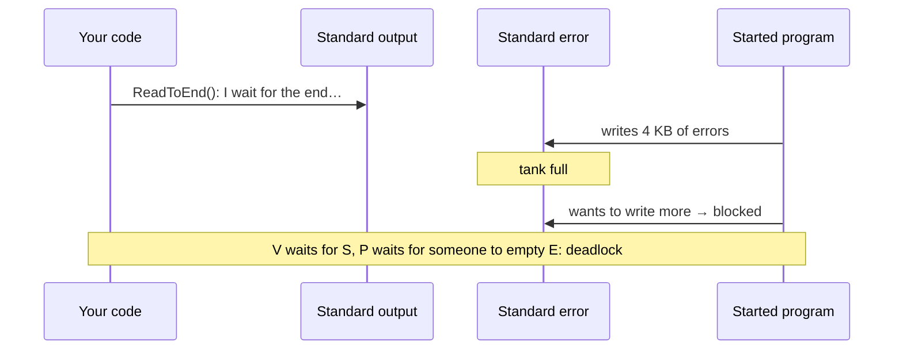

# 06 · Run a command in one line: `Process.RunAndCaptureTextAsync` (.NET 11)

🇫🇷 [Version française](../fr/06-process.md)

> **In one sentence**: `await Process.RunAndCaptureTextAsync("git", ["status"])` starts a program, waits for it to end
> and returns its standard output, its standard error and its exit code, with no deadlock trap.
>
> Code: [`E06_Process.cs`](../../src/DotNet11Features.Examples/Examples/E06_Process.cs) ·
> Run: `dotnet run -c Release --project src/DotNet11Features.Examples -- process`

---

## 1. The idea, simply

### The two pipes

A program started by yours writes into **two pipes**: standard output (the results) and standard error (the
messages). Each pipe has a **small tank** (a few KB). When a tank is full, the program stops and **waits for someone
to empty it**.

The classic trap:

1. you read standard output to the end (`ReadToEnd`);
2. meanwhile, the program writes lots of errors: the error tank fills up;
3. the program waits for you to empty the error tank;
4. you wait for it to close standard output.

Each one waits for the other: **deadlock**, the program never ends. The `Process` documentation has warned about it
since .NET Framework 1.0.



.NET 11 adds methods that do everything right: read both pipes **at the same time**, wait for the end, handle
cancellation.

---

## 2. How we did it before

The **correct** version:

```csharp
var info = new ProcessStartInfo(program)
{
    RedirectStandardOutput = true,
    RedirectStandardError = true,
    UseShellExecute = false,
    CreateNoWindow = true,
    StandardOutputEncoding = Encoding.UTF8,
    StandardErrorEncoding = Encoding.UTF8,
};
foreach (var a in arguments) info.ArgumentList.Add(a);

using var process = Process.Start(info) ?? throw new InvalidOperationException(…);
Task<string> output = process.StandardOutput.ReadToEndAsync();   // both reads at the same time
Task<string> errors = process.StandardError.ReadToEndAsync();
await process.WaitForExitAsync();
return (process.ExitCode, await output, await errors);
```

And even then: does cancellation kill the process? No, `WaitForExitAsync(token)` stops **waiting**, but the program
keeps running. You need a `try/catch` and a `process.Kill(entireProcessTree: true)`.

That is why many projects add a library such as CliWrap or SimpleExec.

---

## 3. What .NET 11 changes

```csharp
ProcessTextOutput r = await Process.RunAndCaptureTextAsync("dotnet", ["--version"]);
r.StandardOutput            // "11.0.100\r\n"
r.StandardError             // ""
r.ExitStatus.ExitCode       // 0
r.ExitStatus.Canceled       // false
r.ProcessId
```

The whole family:

| Method | Returns | Use |
|---|---|---|
| `Process.Run(name, args, silent, timeout)` | `ProcessExitStatus` | Start and wait, output shown (or discarded with `silent: true`) |
| `Process.RunAsync(…, cancellationToken)` | `Task<ProcessExitStatus>` | Same, asynchronous |
| `Process.RunAndCaptureText(name, args, timeout)` | `ProcessTextOutput` | Start, wait, **capture** both outputs |
| `Process.RunAndCaptureTextAsync(…, cancellationToken)` | `Task<ProcessTextOutput>` | Same, asynchronous |
| `Process.StartAndForget(…)` | | Start without waiting or keeping a handle |

Each also accepts a `ProcessStartInfo` for advanced settings (working directory, environment variables…).

### Side by side

<table>
<tr><th>Before</th><th>.NET 11</th></tr>
<tr><td valign="top">

```csharp
var info = new ProcessStartInfo("dotnet")
{
  RedirectStandardOutput = true,
  RedirectStandardError = true,
  UseShellExecute = false,
  CreateNoWindow = true,
};
info.ArgumentList.Add("--version");
using var p = Process.Start(info)!;
var o = p.StandardOutput.ReadToEndAsync();
var e = p.StandardError.ReadToEndAsync();
await p.WaitForExitAsync();
var (code, output) = (p.ExitCode, await o);
```

</td><td valign="top">

```csharp
var r = await Process
  .RunAndCaptureTextAsync(
    "dotnet", ["--version"]);

var (code, output) =
  (r.ExitStatus.ExitCode,
   r.StandardOutput);


```

</td></tr>
<tr><td>

**~14 lines**, deadlock trap if the streams are read one after the other.

</td><td>

**1 statement**, parallel reads and cancellation handled.

</td></tr>
</table>

---

## 4. Output of the example

```
── 06 · Process.RunAndCaptureTextAsync (.NET 11) ────────────
   ▸ After: one line
     code 0 · dotnet --version → 11.0.100 (pid 95876)
     ✓ same result as the version from before
   ▸ Standard error is captured separately, along with the exit code
     code 1 · Exécution impossible, car la commande ou le fichier spécifié est introuvable.
     ✓ a failure does not throw: read ExitStatus.ExitCode
   ▸ Cancellation: the process is stopped
     OperationCanceledException after 507 ms
     ✓ the 30 s process is stopped without waiting for it to end
   ▸ Synchronous version with a timeout: Process.Run
     dotnet --info (output discarded, silent: true) → code 0
     ✓ Process.Run returns the exit status directly
```

(The error message comes from the `dotnet` CLI itself, in the language of the machine it ran on.)

---

## 5. Pitfalls and limits

1. **A non-zero exit code is not an exception.** Remember to test `ExitStatus.ExitCode`; that is intended (many tools
   use code 1 for "nothing found").
2. **Cancellation**: on Windows with SDK 11.0.100, cancelling through the token **throws
   `OperationCanceledException`** after stopping the process (the 30 s command does stop in 0.5 s). The documentation
   also mentions `ExitStatus.Canceled`: the example accepts both behaviors.
3. **Everything is kept in memory.** For a program producing hundreds of MB, stream it with `ReadAllLinesAsync`,
   which returns `ProcessOutputLine` values telling standard output and error apart.
4. **Arguments are a list**, not a string: no quoting problems, no spaces in paths to escape.
5. Other .NET 11 additions around processes: `ProcessStartInfo.KillOnParentExit` (Windows), `StartSuspended`
   (Windows, macOS), `Process.Signal(PosixSignal.SIGTERM)` (Linux, macOS), `Process.TryGetProcessById`.

## Sources

- [What's new in .NET 11 libraries — Process](https://learn.microsoft.com/dotnet/core/whats-new/dotnet-11/libraries)
