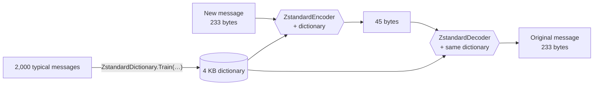

# 07 · Zstandard built into .NET 11

🇫🇷 [Version française](../fr/07-zstandard.md)

> **In one sentence**: `new ZstandardStream(stream, CompressionLevel.Optimal)` is used exactly like `GZipStream`,
> with no NuGet package, and its **trained dictionaries** compress small messages 4 times better.
>
> Code: [`E07_Zstandard.cs`](../../src/DotNet11Features.Examples/Examples/E07_Zstandard.cs) ·
> Run: `dotnet run -c Release --project src/DotNet11Features.Examples -- zstandard`

---

## 1. The idea, simply

### How a compressor works

A compressor looks for **repetitions**: instead of writing `"Status":"shipped"` a second time, it writes "copy the
17 bytes seen 340 bytes earlier". The longer and further it searches, the more repetitions it finds, but the slower
it gets. That is the **level** (or quality) setting.

| Algorithm | Born | Strength |
|---|---|---|
| GZip / Deflate | 1992 | Universal, readable everywhere |
| Brotli | 2015 (Google) | Very good ratio on web text, fast decompression |
| **Zstandard** (zstd) | 2016 (Facebook) | Very **fast** at low levels, **excellent ratio** at high levels, and **dictionaries** |

Zstandard has become a de facto standard: Linux kernel, Arch and Fedora packages, Kafka, databases, HTTP
(`Content-Encoding: zstd` in Chrome and Firefox).

### The dictionary: why small messages compress poorly

A 233-byte JSON message contains too few repetitions **within itself**: GZip barely shrinks it (×1.3). Yet the
1,000 messages of a queue all look alike: same property names, same frequent values.

A **dictionary** is a small block of bytes (here 4 KB) **learned** from typical messages. Compressor and decompressor
share it: each message can then say "copy these 17 bytes **from the dictionary**".



---

## 2. How we did it before

- **GZip or Brotli**, built into .NET: no dictionary, and GZip is slow at its best levels.
- **Zstandard through a third-party package** (ZstdSharp, ZstdNet…): one more dependency, and often a **native DLL**
  to ship for each platform (Windows x64, Linux arm64…), with its deployment headaches.

---

## 3. What .NET 11 changes

`System.IO.Compression` now contains:

| Type | Role |
|---|---|
| `ZstandardStream` | Compression / decompression stream, used like `GZipStream` |
| `ZstandardEncoder` / `ZstandardDecoder` | Stream-less API over `Span<byte>`, with one-line `TryCompress` / `TryDecompress` |
| `ZstandardCompressionOptions` | Quality (1 to 22), window size, checksum, dictionary… |
| `ZstandardDictionary` | `Train(…)` to learn a dictionary, `Create(…)` to load one |

```csharp
// Like GZip: only the type name changes
using (var stream = new ZstandardStream(output, CompressionLevel.Optimal)) stream.Write(data);

// A precise quality
new ZstandardStream(output, new ZstandardCompressionOptions { Quality = 19 }, leaveOpen: false);

// Dictionary
byte[] dictData = ZstandardDictionary.Train(samples, lengths, maxDictionarySize: 4096);
using ZstandardDictionary dict = ZstandardDictionary.Create(dictData, quality: 19);
ZstandardEncoder.TryCompress(message, buffer, out int written, dict, ZstandardCompressionOptions.DefaultWindowLog2);
ZstandardDecoder.TryDecompress(compressed, readBack, out int read, dict);
```

---

## 4. Measured results

`zstandard` demo, 20,000 orders as JSON (4.5 MB), AMD Ryzen 7 9800X3D, Windows 11, .NET 11.0.0, average of
5 runs after warm-up. Times vary by ±10 % between runs; sizes and ratios are exact.

| Algorithm | Size | Ratio | Compress | Decompress |
|---|---:|---:|---:|---:|
| GZip (Optimal) | 338 KB | 13.5× | 20.2 ms | 3.5 ms |
| GZip (SmallestSize) | 316 KB | 14.4× | 57.0 ms | 3.2 ms |
| Brotli (Optimal) | 395 KB | 11.5× | 14.7 ms | 4.5 ms |
| **Zstandard (Optimal)** | 434 KB | 10.5× | **4.3 ms** | 3.2 ms |
| Zstandard (quality 6) | 345 KB | 13.2× | 19.2 ms | 3.3 ms |
| Zstandard (quality 9) | 319 KB | 14.3× | 30.6 ms | 3.6 ms |
| Zstandard (quality 12) | 302 KB | 15.1× | 75.6 ms | 3.2 ms |
| **Zstandard (quality 19)** | **249 KB** | **18.3×** | 1,521 ms | 3.3 ms |

**1,000 small JSON messages** (233 bytes on average), compressed one by one:

| Method | Bytes per message | Ratio |
|---|---:|---:|
| GZip | 176 | 1.3× |
| Zstandard without dictionary | 164 | 1.4× |
| **Zstandard with a 4 KB dictionary** | **45** | **5.1×** |

### Benchmarks (BenchmarkDotNet, short job)

| Compressing 4.5 MB | Time | Time ratio |
|---|---:|---:|
| GZip (Optimal) | 20.1 ms | 1.00 |
| Brotli (Optimal) | 13.7 ms | 0.68 |
| **Zstandard (Optimal)** | **4.1 ms** | **0.20** |
| Zstandard (quality 9) | 29.2 ms | 1.45 |

| 1,000 small messages | Time | |
|---|---:|---|
| Zstandard without dictionary | 3.81 ms | |
| **Zstandard with dictionary** | **1.96 ms** | **1.9× faster**, on top of being 4× smaller |

The dictionary also speeds up compression: the compressor finds repetitions right away in the dictionary instead of
searching for them in a message too short to contain any.

### How to read these numbers

- **`Optimal` does not mean the same thing everywhere.** For Zstandard, it is its default level (3): **5 times faster
  than GZip `Optimal`** but a file 28 % bigger. To get GZip's size, you need quality 6, and then you get roughly the
  same time.
- **.NET's GZip is fast**: since .NET 9 it relies on zlib-ng. The speed gap with Zstandard at equal size is
  therefore small on this data set; do not expect a "magic" gain from just switching algorithms.
- **Zstandard's two real strengths**:
  1. **the range of settings**: from nearly free compression (4 ms for 4.5 MB, handy for logs or a cache) up to −26 %
     size compared with GZip for archives you compress once and read often;
  2. **decompression does not depend on the level**: about 3 ms whether the file was compressed at quality 3 or 19.
- **The dictionary is the decisive feature for small messages** (message queues, distributed cache, database rows,
  telemetry): 4 times smaller than without a dictionary, where GZip gains almost nothing.

---

## 5. Pitfalls and limits

1. **The dictionary must be the same on both sides**, byte for byte. Version it (store its identifier with the data):
   a message compressed with dictionary v1 cannot be read with v2.
2. **Train on representative data**, and different from the data you measure: the example trains on one random seed
   and tests on another.
3. **Qualities above 19** (up to 22) need a lot of memory and time: keep them for archives.
4. **Compatibility**: a `.zst` file produced by .NET can be read by the `zstd` command-line tool, and vice versa
   (standard format, RFC 8878).
5. Other .NET 11 compression additions: span-based codecs `ZLibEncoder`, `GZipEncoder`, `DeflateEncoder` (and their
   decoders), `ZipArchiveEntry.Open(FileAccess)`, ZIP passwords, GNU/Ustar format for `TarFile`.

## Sources

- [What's new in .NET 11 libraries — Compression](https://learn.microsoft.com/dotnet/core/whats-new/dotnet-11/libraries)
- [RFC 8878 — Zstandard Compression](https://www.rfc-editor.org/rfc/rfc8878)
