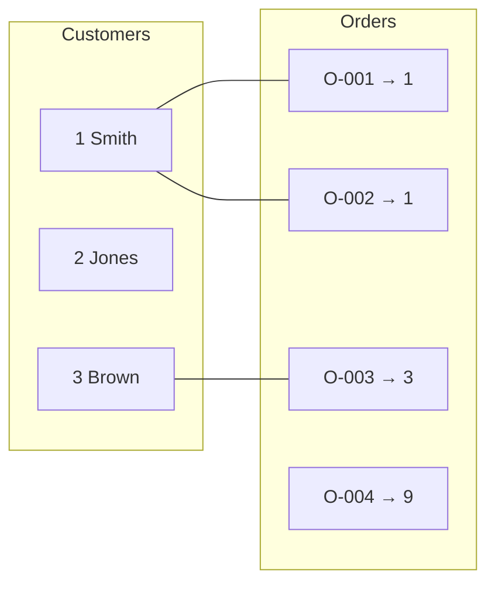

# 08 · LINQ: `FullJoin` and selector-less joins (.NET 11)

🇫🇷 [Version française](../fr/08-jointures-linq.md)

> **In one sentence**: `catalog.FullJoin(stock, a => a.Sku, s => s.Sku)` finally does the full outer join, and every
> join can now be called **without a result selector**: it returns tuples you deconstruct directly.
>
> Code: [`E08_LinqJoins.cs`](../../src/DotNet11Features.Examples/Examples/E08_LinqJoins.cs) ·
> Run: `dotnet run -c Release --project src/DotNet11Features.Examples -- joins`

**What exactly is new** (checked in the .NET 10 and 11 reference assemblies):

| Method | Introduced in |
|---|---|
| `LeftJoin(…, resultSelector)`, `RightJoin(…, resultSelector)` | .NET 10 |
| **`FullJoin`** (with or without a selector) | **.NET 11** |
| **`Join`, `GroupJoin`, `LeftJoin`, `RightJoin` without a selector** (return tuples), optional comparer | **.NET 11** |

---

## 1. The idea, simply

A **join** pairs the items of two lists that share a key: each order with its customer.



Jones has no order, order O-004 has no customer (customer 9 does not exist). Depending on the question, we want to
keep these orphans or not:

| Join | Keeps | Business question | SQL | LINQ |
|---|---|---|---|---|
| Inner | pairs only | "orders with their customer" | `INNER JOIN` | `Join` |
| Left outer | + customers without orders | "every customer, and their orders if any" | `LEFT JOIN` | `LeftJoin` (.NET 10) |
| Right outer | + orders without a customer | "every order, even orphans" | `RIGHT JOIN` | `RightJoin` (.NET 10) |
| Full outer | + both | "reconcile two sources and list the gaps" | `FULL OUTER JOIN` | **`FullJoin` (.NET 11)** |

---

## 2. How we did it before

Up to .NET 9, the left outer join was written like this:

```csharp
var result = Customers
    .GroupJoin(Orders, c => c.Id, o => o.CustomerId, (customer, orders) => new { customer, orders })
    .SelectMany(x => x.orders.DefaultIfEmpty(), (x, o) => (x.customer.Name, Number: o?.Number ?? "(none)"));
```

.NET 10 added `LeftJoin` and `RightJoin`, but **still with a mandatory result selector**:

```csharp
Customers.LeftJoin(Orders, c => c.Id, o => o.CustomerId, (customer, order) => (customer, order));
//                                                       ^^^^^^^^^^^^^^^^^^^^^^^^^^^^^^^^^^^^^^ just to build a tuple
```

And the **full** join still did not exist: a left join, then the right-hand orphans added after checking they have no
match.

```csharp
var full = Catalog
    .GroupJoin(Stock, a => a.Sku, s => s.Sku, (a, s) => new { a, s })
    .SelectMany(x => x.s.DefaultIfEmpty(), (x, s) => (x.a.Sku, Item: (CatalogItem?)x.a, Stock: s))
    .Concat(Stock.Where(s => !Catalog.Any(a => a.Sku == s.Sku))
                 .Select(s => (s.Sku, Item: (CatalogItem?)null, Stock: (WarehouseStock?)s)));
```

---

## 3. What .NET 11 changes

```csharp
// FullJoin: either side can be null
foreach (var (item, stock) in Catalog.FullJoin(Stock, a => a.Sku, s => s.Sku)) …

// Every join without a selector: (Outer, Inner) tuples to deconstruct
foreach (var (customer, order) in Customers.LeftJoin(Orders, c => c.Id, o => o.CustomerId)) …
foreach (var (customer, order) in Customers.RightJoin(Orders, c => c.Id, o => o.CustomerId)) …

// An optional key comparer
Catalog.Join(stock, a => a.Sku, s => s.Sku, StringComparer.OrdinalIgnoreCase);
```

`FullJoin` goes very well with a `switch` on the tuple:

```csharp
string diagnosis = (item, stock) switch
{
    (not null, not null) => $"OK, {stock.Quantity} in stock",
    (not null, null)     => "in the catalog but never received in the warehouse",
    (null, not null)     => "in the warehouse but missing from the catalog!",
    (null, null)         => "impossible",
};
```

These operators exist for `Enumerable`, `Queryable` and `AsyncEnumerable`.

### Side by side

<table>
<tr><th>Before</th><th>.NET 11</th></tr>
<tr><td valign="top">

```csharp
Catalog
  .GroupJoin(Stock,
    a => a.Sku, s => s.Sku,
    (a, s) => new { a, s })
  .SelectMany(
    x => x.s.DefaultIfEmpty(),
    (x, s) => (x.a, s))
  .Concat(Stock
    .Where(s => !Catalog
      .Any(a => a.Sku == s.Sku))
    .Select(s => (null, s)));
```

</td><td valign="top">

```csharp
Catalog
  .FullJoin(Stock,
    a => a.Sku, s => s.Sku);


```

</td></tr>
</table>

---

## 4. Results

### Output of the example

```
   ▸ .NET 11: Catalog.FullJoin(Stock, a => a.Sku, s => s.Sku)
     COFFEE  OK, 120 in stock
     TEA     in the catalog but never received in the warehouse
     MUG     OK, 8 in stock
     FILTER  in the warehouse but missing from the catalog!
     ✓ 4 rows: COFFEE, TEA, MUG and FILTER, like the manual version
```

### Benchmarks (BenchmarkDotNet, 10,000 customers × 30,000 orders, short job)

| Method | Time | Memory |
|---|---:|---:|
| Before .NET 10: GroupJoin + SelectMany + DefaultIfEmpty | 2.26 ms | 3.96 MB |
| .NET 10: LeftJoin | 2.14 ms | 2.84 MB (−28 %) |
| Before: manual full join (with a `HashSet` of keys) | 1.70 ms | 4.48 MB |
| **.NET 11: FullJoin** | 3.44 ms (**×2.0**) | 3.49 MB (−22 %) |

### How to read these numbers

- **`FullJoin` is slower than a well-written manual version** in this case (a third of the orders are orphans). It
  stays much simpler, allocates less, and the "naive" manual version of the demo (one `Any()` per item instead of a
  `HashSet`) would be quadratic. On a critical path with large volumes, measure.
- **`LeftJoin` matches the old incantation in speed** and allocates 28 % less.
- With an `IQueryable` provider (Entity Framework Core…), the database does the join: performance is a SQL question,
  provided the provider can translate the operator.

---

## 5. Pitfalls and limits

1. **The missing side is `default`**: `null` for a class, but `0` or `default(T)` for a struct or a tuple. To tell
   "missing" from "null value" apart, use reference types or `Nullable<T>`.
2. **Order**: `LeftJoin` keeps the order of the left sequence; `FullJoin` first returns the left items (matched or
   not), then the right-hand orphans.
3. **Duplicate keys**: as in SQL, a customer with two orders produces two rows.

## Sources

- [What's new in .NET 11 libraries — LINQ](https://learn.microsoft.com/dotnet/core/whats-new/dotnet-11/libraries)
- [What's new in .NET 10 libraries — LeftJoin and RightJoin](https://learn.microsoft.com/dotnet/core/whats-new/dotnet-10/libraries)
