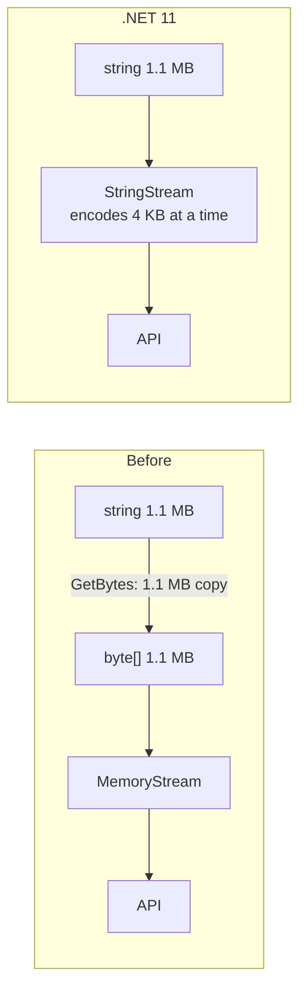

# 09 · New `Stream` types: `StringStream`, `ReadOnlyMemoryStream`, `WritableMemoryStream`, `ReadOnlySequenceStream` (.NET 11)

🇫🇷 [Version française](../fr/09-flux.md)

> **In one sentence**: four streams that expose a string, a memory region or a Pipelines sequence as a `Stream`,
> **without copying the data**.
>
> Code: [`E09_Streams.cs`](../../src/DotNet11Features.Examples/Examples/E09_Streams.cs) ·
> Run: `dotnet run -c Release --project src/DotNet11Features.Examples -- streams`

---

## 1. The idea, simply

### The tap

A `Stream` is a **tap**: you draw bytes as you go, without knowing where they come from (file, network, memory). A
huge number of .NET APIs ask for a tap: `JsonSerializer.Deserialize(Stream)`, `XmlReader.Create(Stream)`,
`HttpContent`, compressors, cloud storage APIs…

Problem: your data is not always in a compatible **bucket**. Before .NET 11, the only "tap on memory" was
`MemoryStream`, which only accepts a `byte[]`. If your data was:

- a **string** (`string`, so characters, not bytes);
- a **slice** of a buffer (`ReadOnlyMemory<byte>`, often from a pool);
- a **chunked sequence** (`ReadOnlySequence<byte>`, what System.IO.Pipelines hands out);

… you first had to **pour everything** into a new `byte[]`. For 1 MB of data, 1 MB of copying.

| Your data | Before .NET 11 | .NET 11 |
|---|---|---|
| `string` | `new MemoryStream(Encoding.UTF8.GetBytes(s))` | `new StringStream(s, Encoding.UTF8)` |
| `ReadOnlyMemory<byte>` | `new MemoryStream(m.ToArray())` | `new ReadOnlyMemoryStream(m)` |
| `Memory<byte>` (to write) | a `MemoryStream` that grows on its own | `new WritableMemoryStream(m)` (fixed size) |
| `ReadOnlySequence<byte>` | `new MemoryStream(seq.ToArray())` | `new ReadOnlySequenceStream(seq)` |



---

## 2. How we did it before

```csharp
// A JSON string received from somewhere, to pass to an API that expects a Stream
using var stream = new MemoryStream(Encoding.UTF8.GetBytes(json));       // full copy

// A slice of a larger buffer
using var stream2 = new MemoryStream(slice.ToArray());                  // copy of the slice

// A Pipelines sequence
using var stream3 = new MemoryStream(sequence.ToArray());               // flattened into one array
```

Many projects had their own home-made `ReadOnlyMemoryStream` or `StringStream` (ASP.NET Core has several
internally), each with its own bugs around `Seek` or `ReadAsync`.

---

## 3. What .NET 11 changes

```csharp
using var stream = new StringStream(json, Encoding.UTF8);              // encodes as it is read
var orders = JsonSerializer.Deserialize<List<Order>>(stream);

using var stream2 = new ReadOnlyMemoryStream(slice);                    // read-only, no copy

using var output = new WritableMemoryStream(rentedBuffer.AsMemory(0, 256));   // writes into YOUR buffer
JsonSerializer.Serialize(output, value);

using var stream3 = new ReadOnlySequenceStream(sequence);               // reads segment by segment
```

---

## 4. Results

### Output of the example (memory allocated to read the whole stream)

```
     A 1,145 K-character JSON string to pass to an API that expects a Stream
   ▸ Before: new MemoryStream(Encoding.UTF8.GetBytes(text)) → full copy as bytes
     memory allocated:    1,146 KB
   ▸ After: new StringStream(text, Encoding.UTF8) → encoded as it is read
     memory allocated:        0 KB
   ▸ Before: MemoryStream requires a byte[] → ToArray() on a ReadOnlyMemory<byte> = a copy
     memory allocated:       98 KB
   ▸ After: new ReadOnlyMemoryStream(slice) → no copy, read-only
     memory allocated:        0 KB
   ▸ WritableMemoryStream: write into a rented buffer that never grows
     42 bytes written into the rented buffer: {"Number":"ORD-2026-000042","Amount":42.5}
     ✓ going past the capacity throws NotSupportedException (a MemoryStream would have reallocated)
   ▸ ReadOnlySequenceStream: read a ReadOnlySequence<byte> (Pipelines) without flattening it
     1,145 KB sequence in 287 segments
     before, sequence.ToArray() + MemoryStream:    1,146 KB
     after, new ReadOnlySequenceStream(seq):           0 KB
```

### Benchmark: deserialize 5,000 orders (1.1 MB of JSON) from a string

| Method | Time | Memory |
|---|---:|---:|
| Before: `MemoryStream(Encoding.UTF8.GetBytes(json))` | 5.73 ms | 5.45 MB |
| **After: `StringStream(json, Encoding.UTF8)`** | **4.13 ms (−28 %)** | **4.33 MB (−21 %)** |

### How to read these numbers

- The **exact** memory gain is the size of the data: 1.1 MB less per call. The rest of the 4.3 MB is the
  deserialized objects themselves.
- The time gain mostly comes from the **garbage collector**: a 1.1 MB array goes to the large object heap (LOH,
  above 85 KB), which is expensive to collect. The benchmark shows 242 generation 2 collections per 1,000 calls
  before, **none** after.

---

## 5. Pitfalls and limits

1. **`StringStream` is not seekable** (`CanSeek` is `false`): its position in bytes depends on the encoding. An API
   that needs `Length` or to go back still requires a `MemoryStream`.
2. **`ReadOnlyMemoryStream` does not keep the buffer alive beyond your code**: if that buffer comes from an
   `ArrayPool`, do not return it while the stream is in use.
3. **`WritableMemoryStream` has a fixed size**: writing past it throws `NotSupportedException`. That is the point (no
   surprise reallocation), but the buffer must be sized.
4. These types live in `System.IO` (CoreLib): no package to add.

## Sources

- [What's new in .NET 11 libraries — Stream types](https://learn.microsoft.com/dotnet/core/whats-new/dotnet-11/libraries)
