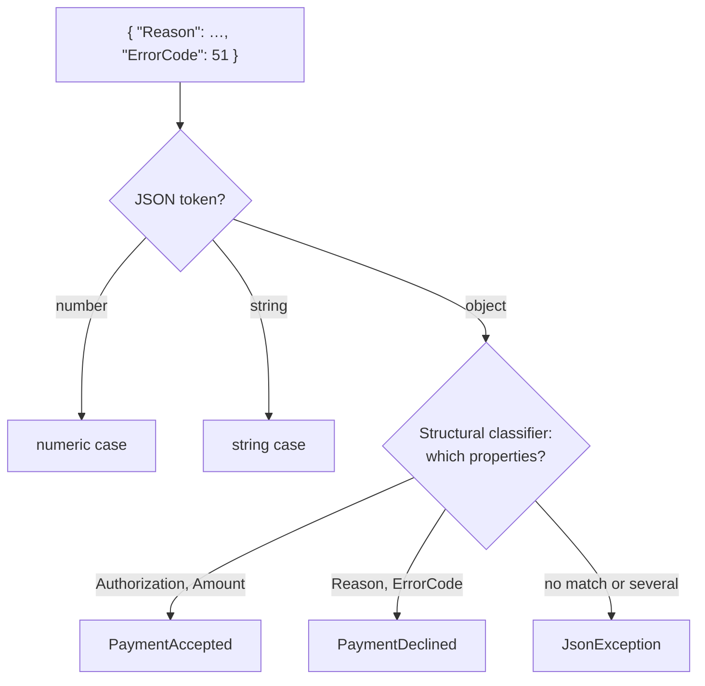

# 10 · System.Text.Json: unions, closed hierarchies, per-type naming (.NET 11)

🇫🇷 [Version française](../fr/10-json-unions.md)

> **In one sentence**: System.Text.Json can serialize C# 15 [unions](01-unions.md), guess the case of a JSON object
> from its properties, infer the polymorphism of a [closed hierarchy](02-closed-hierarchies.md), and apply a naming
> policy to a single type.
>
> Code: [`E10_JsonUnions.cs`](../../src/DotNet11Features.Examples/Examples/E10_JsonUnions.cs) ·
> Run: `dotnet run -c Release --project src/DotNet11Features.Examples -- json`

---

## 1. The idea, simply

A payment provider answers **either** `{"Authorization":"A1B2C3","Amount":42.5}` **or**
`{"Reason":"Insufficient funds","ErrorCode":51}`. There is **no "type" field**: the shape of the object tells what
it is. That is very common with APIs you do not control.

To deserialize that, you have to **look at the properties present** before choosing the class. Until now,
System.Text.Json only did polymorphism with an explicit discriminator (`"$type": "…"`).

.NET 11 brings:

| Need | Before | .NET 11 |
|---|---|---|
| Pick the type from the shape of the JSON | home-made `JsonConverter` | `union` + `JsonUnionTypeStructuralClassifier` |
| Union of simple values (`double` or `string`) | home-made `JsonConverter` | `union Reading(double, string)`, nothing to configure |
| Polymorphism of a hierarchy | one `[JsonDerivedType]` per class | `closed` + `InferClosedTypePolymorphism = true` |
| snake_case for one type only | one `[JsonPropertyName]` per property | `[JsonNamingPolicy(SnakeCaseLower)]` on the type |
| Global PascalCase | home-made policy | `JsonNamingPolicy.PascalCase` |

---

## 2. How we did it before

```csharp
public sealed class PaymentResponseConverterBefore : JsonConverter<object>
{
    public override object Read(ref Utf8JsonReader reader, Type type, JsonSerializerOptions options)
    {
        using var doc = JsonDocument.ParseValue(ref reader);                   // loads the whole object
        if (doc.RootElement.TryGetProperty("Authorization", out _)) return doc.RootElement.Deserialize<PaymentAccepted>(options)!;
        if (doc.RootElement.TryGetProperty("Reason", out _)) return doc.RootElement.Deserialize<PaymentDeclined>(options)!;
        throw new JsonException("Unknown payment response");
    }

    public override void Write(Utf8JsonWriter writer, object value, JsonSerializerOptions options) =>
        JsonSerializer.Serialize(writer, value, value.GetType(), options);
}
```

And for a hierarchy, the list to keep up to date:

```csharp
[JsonPolymorphic]
[JsonDerivedType(typeof(PercentDiscountBefore), "PercentDiscountBefore")]
[JsonDerivedType(typeof(AmountDiscountBefore), "AmountDiscountBefore")]   // forget a line = runtime exception
public abstract record DiscountBefore;
```

---

## 3. What .NET 11 changes

```csharp
[JsonUnion(TypeClassifier = typeof(JsonUnionTypeStructuralClassifier))]
public union PaymentResponse(PaymentAccepted, PaymentDeclined);

PaymentResponse r = JsonSerializer.Deserialize<PaymentResponse>(json);
string text = r switch
{
    PaymentAccepted a => $"accepted, authorization {a.Authorization}",
    PaymentDeclined d => $"declined ({d.ErrorCode}): {d.Reason}",
};
```

The **structural classifier** compares the property names present in the JSON object with those of each case. Zero
or several matches: `JsonException`.



```csharp
[JsonPolymorphic(InferClosedTypePolymorphism = true)]
public closed record Discount;               // derived types are found in the "closed" metadata
public record PercentDiscount(int Percent) : Discount;
public record AmountDiscount(decimal Amount) : Discount;

[JsonNamingPolicy(JsonKnownNamingPolicy.SnakeCaseLower)]
public record Webhook(string EventId, DateTimeOffset CreatedAt, long AmountCents);
```

---

## 4. Output of the example

```
   ▸ Union of simple values: written as is, with no wrapper and no $type
     [21.5,"sensor offline"]
   ▸ After: [JsonUnion(TypeClassifier = typeof(JsonUnionTypeStructuralClassifier))]
     {"Authorization":"A1B2C3","Amount":42.5}                → accepted, authorization A1B2C3 for 42.5 €
     {"Reason":"Insufficient funds","ErrorCode":51}          → declined (51): Insufficient funds
     ✓ the case is picked from the property names present
     ✓ an object that matches no case throws JsonException
   ▸ Closed hierarchy: InferClosedTypePolymorphism replaces the list of [JsonDerivedType]
     before: [{"$type":"PercentDiscountBefore","Percent":10},{"$type":"AmountDiscountBefore","Amount":5}]
     after:  [{"$type":"PercentDiscount","Percent":10},{"$type":"AmountDiscount","Amount":5}]
   ▸ Type-level naming policy: [JsonNamingPolicy(SnakeCaseLower)]
     before (3 attributes): {"event_id":"evt_42","created_at":"2026-11-10T09:00:00+00:00","amount_cents":4250}
     after (1 attribute):   {"event_id":"evt_42","created_at":"2026-11-10T09:00:00+00:00","amount_cents":4250}
   ▸ And the new global JsonNamingPolicy.PascalCase
     {"OrderNumber":"O-001","TotalAmount":42.5}
```

Inferred polymorphism uses **the class name** as the discriminator (`"$type":"PercentDiscount"`).

---

## 5. Pitfalls and limits

1. **Two cases with the same JSON shape are ambiguous.** `union CustomerId(int, Guid, string)` serializes fine, but
   **deserializes** badly: a `Guid` and a `string` are both JSON strings. Error we got while testing it:
   ```
   JsonException: JSON value type 'String' is ambiguous for union type 'CustomerId' because multiple case
   types can use this value type. Specify a custom type classifier to support deserialization.
   ```
   Fix: a custom classifier (`JsonTypeClassifierFactory`), or avoid that mix in a union meant for JSON.
2. **The structural classifier** does not support nested unions, polymorphic cases, or
   `ReferenceHandler.Preserve`.
3. **Renaming a class changes the JSON** when the discriminator is inferred (`$type` = class name). For a stable
   public contract, keep explicit `[JsonDerivedType(typeof(X), "stable-name")]` attributes: they replace the inferred
   list.
4. **Naming precedence**: `[JsonPropertyName]` > `[JsonNamingPolicy]` on the property > `[JsonNamingPolicy]` on the
   type > `JsonSerializerOptions.PropertyNamingPolicy` > C# name.
5. **File-based apps and Native AOT**: reflection-based serialization is disabled there by default; you need a
   `JsonSerializerContext` (source generator) or `#:property PublishAot=false`.

## Sources

- [What's new in .NET 11 libraries — System.Text.Json](https://learn.microsoft.com/dotnet/core/whats-new/dotnet-11/libraries)
