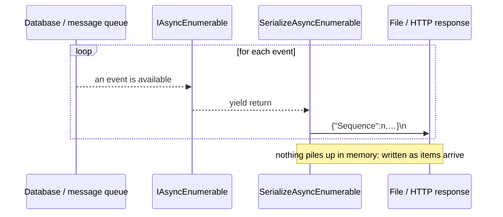

# 11 · JSON Lines: `JsonSerializer.SerializeAsyncEnumerable` (.NET 11)

🇫🇷 [Version française](../fr/11-json-lines.md)

> **In one sentence**: `await JsonSerializer.SerializeAsyncEnumerable(stream, source, topLevelValues: true)` writes an
> async stream in JSON Lines format (one object per line), as items arrive.
>
> Code: [`E11_JsonLines.cs`](../../src/DotNet11Features.Examples/Examples/E11_JsonLines.cs) ·
> Run: `dotnet run -c Release --project src/DotNet11Features.Examples -- jsonl`

---

## 1. The idea, simply

### An array or lines?

To send 10,000 events, you can write **a single JSON array**:

```json
[{"Sequence":1,…},{"Sequence":2,…}, … ,{"Sequence":10000,…}]
```

or **one value per line**, the **JSON Lines** format (`.jsonl`, also called NDJSON):

```
{"Sequence":1,"Type":"paid","Order":"ORD-0001"}
{"Sequence":2,"Type":"shipped","Order":"ORD-0001"}
{"Sequence":3,"Type":"created","Order":"ORD-0002"}
```

JSON Lines has big advantages:

- you can **append** to the end of a file without reading it back (logs, audit);
- **a broken line does not break the others**;
- command-line tools (`grep`, `head`, `wc -l`) work line by line;
- it is the input format of many services: Elasticsearch/OpenSearch bulk imports, BigQuery, AI training data sets,
  streamed responses of some APIs.

### And "async"?

`IAsyncEnumerable<T>` is a source that produces its items **over time** (database read, message queue).
`SerializeAsyncEnumerable` writes each item **as soon as it arrives**, without waiting for the end or keeping
everything in memory.

---

## 2. How we did it before

.NET 9 could already **read** JSON Lines (`DeserializeAsyncEnumerable(stream, topLevelValues: true)`), but not
**write** it. You wrote the loop yourself:

```csharp
byte[] newline = "\n"u8.ToArray();
await foreach (var e in source)
{
    await JsonSerializer.SerializeAsync(output, e);   // careful: never WriteIndented here
    await output.WriteAsync(newline);
}
```

Three traps: forgetting that `WriteIndented = true` breaks the format (one object over several lines), writing
`\r\n` on Windows with `WriteLine`, and creating a new JSON writer for every item.

---

## 3. What .NET 11 changes

```csharp
await JsonSerializer.SerializeAsyncEnumerable(output, Events(), topLevelValues: true);   // JSON Lines
await JsonSerializer.SerializeAsyncEnumerable(output, Events());                         // an array [ … ]
```

Four overloads: to a `Stream` or a `PipeWriter`, with `JsonSerializerOptions` or a `JsonTypeInfo<T>` (source
generator, Native AOT compatible).



### Side by side

<table>
<tr><th>Before</th><th>.NET 11</th></tr>
<tr><td valign="top">

```csharp
var nl = "\n"u8.ToArray();
await foreach (var e in source)
{
  await JsonSerializer
    .SerializeAsync(output, e);
  await output.WriteAsync(nl);
}
```

</td><td valign="top">

```csharp
await JsonSerializer
  .SerializeAsyncEnumerable(
    output, source,
    topLevelValues: true);


```

</td></tr>
</table>

---

## 4. Results

### Output of the example

```
   ▸ After: SerializeAsyncEnumerable(stream, source, topLevelValues: true)
     {"Sequence":1,"Type":"paid","Order":"ORD-0001"}
     {"Sequence":2,"Type":"shipped","Order":"ORD-0001"}
     {"Sequence":3,"Type":"created","Order":"ORD-0002"}
     ✓ byte for byte the same result as the manual loop
     ✓ every line, including the last one, ends with \n (never \r\n, even on Windows)
   ▸ Indentation options are ignored: one value = one line, always
     ✓ WriteIndented = true does not break the format (2 objects = 2 lines)
   ▸ Round trip: DeserializeAsyncEnumerable(…, topLevelValues: true) reads the file back
     516 KB written, 10000 events read back, last #10000
```

### Benchmark: write 10,000 events

| Method | Time | Memory |
|---|---:|---:|
| Before: `SerializeAsync` loop + `\n` | 1.26 ms | 3.21 MB |
| **After: `SerializeAsyncEnumerable(…, topLevelValues: true)`** | **1.04 ms (−18 %)** | **1.38 MB (−57 %)** |

The gain comes from reusing a single JSON writer and its buffers for the whole stream, instead of one per item.

---

## 5. Pitfalls and limits

1. **Always `\n`**, never `\r\n`, whatever `JsonSerializerOptions.NewLine` says: that is what the format requires.
2. **`WriteIndented` is ignored** in `topLevelValues: true` mode. In array mode, it applies as usual.
3. **For an HTTP response** in ASP.NET Core, use the `PipeWriter` overload with `Response.BodyWriter` and the
   `application/jsonl` content type (or `application/x-ndjson` depending on the client).

## Sources

- [What's new in .NET 11 libraries — System.Text.Json](https://learn.microsoft.com/dotnet/core/whats-new/dotnet-11/libraries)
- [JSON Lines](https://jsonlines.org/)
