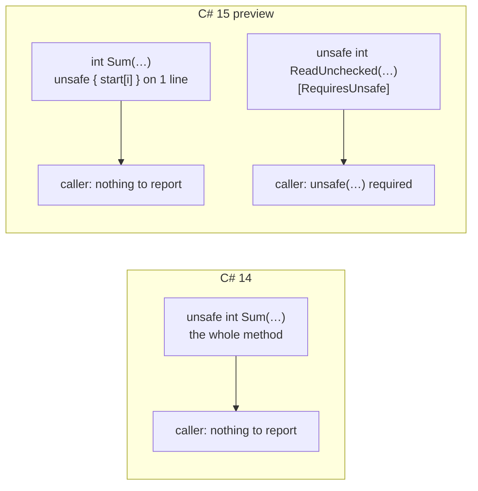

# 15 · New memory safety model (C# 15, **preview**)

🇫🇷 [Version française](../fr/15-securite-memoire.md)

> **In one sentence**: declaring a pointer, taking an address or using `fixed` no longer require `unsafe`; only the
> **dereference** is dangerous and must be marked, as narrowly as possible, with `unsafe { }` or `unsafe(expr)`. And
> `unsafe` on a method now means "**the caller** takes responsibility".
>
> Code: [`src/DotNet11Features.MemorySafety/Program.cs`](../../src/DotNet11Features.MemorySafety/Program.cs) ·
> Run: `dotnet run -c Release --project src/DotNet11Features.MemorySafety`

> ⚠️ **Preview feature in .NET 11.** It needs three settings, hence a separate project: the rest of the solution
> stays on stable C# 15. Syntax and rules may still change in .NET 12.

```xml
<PropertyGroup>
  <LangVersion>preview</LangVersion>
  <Features>$(Features);updated-memory-safety-rules</Features>
  <AllowUnsafeBlocks>true</AllowUnsafeBlocks>
</PropertyGroup>
```

---

## 1. The idea, simply

### What is really dangerous about a pointer?

A pointer is an **address**: "memory cell #0x7FF6…". Having an address in a variable harms nobody. What is dangerous
is **reading or writing at that address** without checks: if it is wrong (outside the array, freed object), you read
garbage or overwrite someone else's memory.

| Operation | Example | Dangerous? |
|---|---|---|
| Declare a pointer | `int* p;` | no |
| Take an address | `&value` | no |
| Pin an array | `fixed (int* p = array)` | no |
| Size of a type | `sizeof(MyStruct)` | no |
| **Read / write at the address** | `*p`, `p[i]`, `p->x` | **yes** |
| **Call a function pointer** | `fn(…)` | **yes** |

Up to C# 14, **all** these operations required an `unsafe` context. Result: a whole method gets marked `unsafe`, and
a reviewer no longer knows which line deserves attention.

### The Rust parallel

This is exactly Rust's model: `unsafe { }` around the dangerous operations only, and `unsafe fn` for a function whose
**caller** must guarantee conditions ("the index is inside the array").

---

## 2. How we did it before (C# 14)

```csharp
public static unsafe int SumBefore(int[] values)        // the whole method is unsafe
{
    int total = 0;
    fixed (int* start = values)
    {
        for (int i = 0; i < values.Length; i++) total += start[i];
    }
    return total;
}

int s = Calculations.SumBefore(readings);               // the caller sees nothing
```

The same code, compiled with the new rules, **no longer compiles** (errors we got while writing the example;
messages translated from the French-language compiler output):

```
error CS9360: This operation may only be used in an unsafe context                ← start[i]
error CS9362: 'Calculations.SumBefore(int[])' must be used in an unsafe context
              because it is marked as 'unsafe'                                     ← at the call site
```

Two changes of meaning show up:

1. `unsafe` on a method **no longer makes its body unsafe**: `start[i]` must be marked itself.
2. `unsafe` on a method **requires an unsafe context at the call site**.

---

## 3. What C# 15 changes (preview)

```csharp
public static int Sum(int[] values)                      // ordinary method
{
    int total = 0;
    fixed (int* start = values)                          // safe: pin and take the address
    {
        for (int i = 0; i < values.Length; i++)
        {
            unsafe { total += start[i]; }                // ← the only line to review carefully
        }
    }
    return total;
}

public static byte FirstByte(int value)
{
    int* address = &value;                               // safe
    byte* b = (byte*)address;                            // safe
    return unsafe(*b);                                   // new unsafe(…) expression
}

/// <remarks>Safety: the caller guarantees that index is inside the pointed array.</remarks>
public static unsafe int ReadUnchecked(int* values, int index) => unsafe(values[index]);

// At the call site:
// Calculations.ReadUnchecked(p, 1);                     ← CS9362
int value = unsafe(Calculations.ReadUnchecked(p, 1));    // the caller "signs" that it honors the contract
```



### What the compiler writes into the binary

```
[System.Runtime.CompilerServices.MemorySafetyRulesAttribute((Int32)2)]      ← on the module
attributes of ReadUnchecked: RequiresUnsafeAttribute
```

Other assemblies therefore see the requirement: a library compiled with the new rules forces `unsafe(…)` on the
projects that use it, when those are compiled with the same rules.

---

## 4. Output of the example

```
── 15 · New memory safety model (C# 15, preview) ──
   ▸ Pointers, & and fixed without "unsafe"; only the dereference is marked
     sum = 31
     ✓ the only unsafe block of the method surrounds the start[i] read
   ▸ unsafe(expression): a single dangerous expression in the middle of safe code
     first byte of 0x11223344 in memory: 0x44
     ✓ the byte order in memory is read through a pointer
   ▸ A method marked unsafe: now it is the CALLER that must take responsibility
     ReadUnchecked(p, 1) = 20
     ✓ the call compiles only inside unsafe(…)
   ▸ What the compiler writes into the binary
     [System.Runtime.CompilerServices.MemorySafetyRulesAttribute((Int32)2)]
     ✓ the binary declares the rules it was compiled with
     attributes of ReadUnchecked: RequiresUnsafeAttribute
     ✓ an unsafe method carries [RequiresUnsafe]: other assemblies see the requirement
```

No impact on the generated code: these are **compile-time** rules. The machine code is identical.

---

## 5. Pitfalls and limits

1. **Preview**: `LangVersion=preview` also turns on every other preview feature of the compiler. Keep it to an
   isolated project, as here.
2. **Migrating existing code is not transparent**: every `unsafe` method changes meaning (see § 2). You need to add
   `unsafe { }` in bodies and at call sites.
3. The new contextual keyword `safe` declares `extern` members or fields of explicit-layout structs as safe; not
   shown here.

## Sources

- [What's new in C# 15 — Memory safety (preview)](https://learn.microsoft.com/dotnet/csharp/whats-new/csharp-15)
