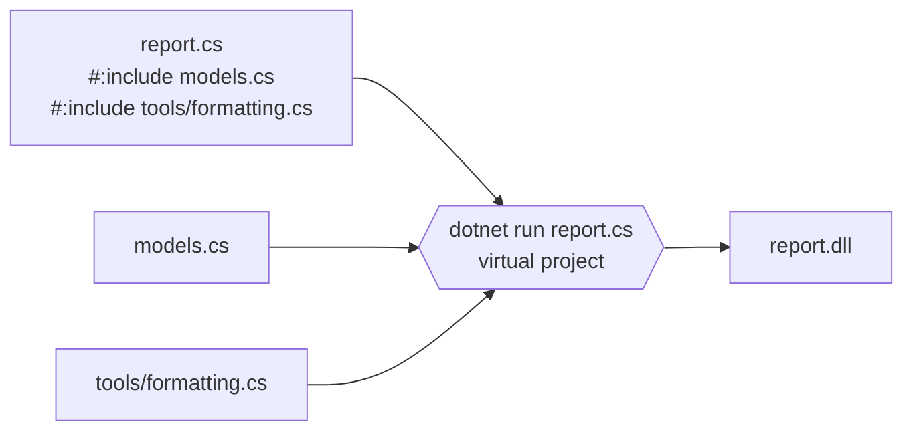

# 16 · File-based apps: `#:include` (.NET 11 SDK)

🇫🇷 [Version française](../fr/16-applications-fichier.md)

> **In one sentence**: a C# app without a `.csproj` (`dotnet run report.cs`, introduced in .NET 10) can now **include
> other files** with `#:include models.cs`.
>
> Code: [`file-based-app/report.cs`](../../file-based-app/report.cs),
> [`models.cs`](../../file-based-app/models.cs), [`tools/formatting.cs`](../../file-based-app/tools/formatting.cs) ·
> Run: `dotnet run file-based-app/report.cs -- Lyon`

---

## 1. The idea, simply

.NET 10 introduced **file-based apps**: a plain `script.cs`, run with `dotnet run script.cs`, with no project and no
solution. Settings that used to live in the `.csproj` move into **directives** at the top of the file:

```csharp
#:package Humanizer@2.14.1          // a NuGet dependency
#:property LangVersion=preview      // an MSBuild property
#:sdk Microsoft.NET.Sdk.Web         // another SDK
```

Great for tools, admin scripts, prototypes. But **a single file**: as soon as the script grows, you want to move the
models or utilities into separate files, or **share them between several scripts**. In .NET 10, the only way out
was converting to a project (`dotnet project convert`).

---

## 2. What the .NET 11 SDK changes

```csharp
#!/usr/bin/env dotnet
#:include models.cs
#:include tools/formatting.cs
#:property Company="Coffee & Tea Shop"
#:property PublishAot=false
```

| Directive | New in .NET 11 |
|---|---|
| `#:include file.cs` | includes a C# file (relative path, sub-folders included) |
| `#:include ./libs/MyLib.dll` | references a DLL |
| `#:property Name="value with spaces"` | quoted values |
| `#:package Package@1.0 Aliases=Alias` | metadata on a package reference |
| Repeated directives | allowed when values are identical (useful when two included files declare the same package) |

And around it: `dotnet format app.cs`, `dotnet reference add --file app.cs <project>`, `dotnet run -e KEY=VALUE`.



---

## 3. Side by side

<table>
<tr><th>.NET 10: everything in one file</th><th>.NET 11: #:include</th></tr>
<tr><td valign="top">

```csharp
// report.cs, 120 lines:
// the report code
// + the records
// + the sample data
// + the formatting helpers
// (copied into every script
//  that needs them)
```

</td><td valign="top">

```csharp
// report.cs, 25 lines
#:include models.cs
#:include tools/formatting.cs

// models.cs, tools/formatting.cs:
// shared by several scripts

```

</td></tr>
</table>

---

## 4. Output

```
> dotnet run file-based-app/report.cs
Report all cities — Coffee & Tea Shop
  Lyon         2 order(s)       49,50 €
  Nantes       1 order(s)       99,00 €
  Paris        2 order(s)       84,20 €
  Total        5 order(s)      232,70 €

> dotnet run file-based-app/report.cs -- Lyon
Report Lyon — Coffee & Tea Shop
  Lyon         2 order(s)       49,50 €
  Total        2 order(s)       49,50 €
```

The `#:property Company="Coffee & Tea Shop"` property (quoted value, with spaces and `&`) does reach the
`AssemblyCompany` attribute read by the program. Amounts use the `fr-FR` culture on purpose (euros).

---

## 5. Pitfalls and limits

1. **Start the main file with `#!`**: without a *shebang* line, the CA2266 analyzer warns that the entry point of a
   file-based program should start with `#!`. Hit while writing the example. The `#!/usr/bin/env dotnet` line also
   lets you run the script directly on Linux and macOS (`chmod +x`).
2. **Native AOT is on by default** for a file-based app: reflection-based JSON serialization is disabled. Hence
   `#:property PublishAot=false` here (or a `JsonSerializerContext`).
3. **`Directory.Build.props` applies** to file-based apps as it does to projects: this one inherits the repository's
   `net11.0`.
4. **A property name cannot contain `:`** in `#:property`.

## Sources

- [What's new in the .NET 11 SDK — File-based apps](https://learn.microsoft.com/dotnet/core/whats-new/dotnet-11/sdk)
