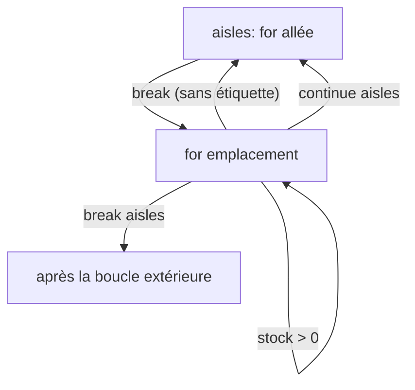

# 05 · `break` et `continue` étiquetés (C# 15)

🇬🇧 [English version](../en/05-labeled-break-continue.md)

> **En une phrase** : `aisles: for (…) { for (…) { … break aisles; } }` sort directement de la boucle extérieure,
> sans variable « trouvé » ni `goto`.
>
> Code : [`E05_LabeledLoops.cs`](../../src/DotNet11Features.Examples/Examples/E05_LabeledLoops.cs) ·
> Lancer : `dotnet run -c Release --project src/DotNet11Features.Examples -- loops`

---

## 1. L'idée expliquée simplement

Dans un entrepôt de 4 allées × 5 emplacements, on cherche le **premier emplacement vide**. Deux boucles imbriquées :
les allées (`aisle`), puis les emplacements (`slot`) de chaque allée.

Quand on trouve, on veut **tout arrêter**. Mais `break` ne sort que de la boucle **la plus proche** : on se retrouve
dans la boucle des allées, qui passe tranquillement à l'allée suivante.

C# 15 permet de **nommer une boucle** et de dire de laquelle on sort. Java, JavaScript, Kotlin, Rust, Go et Swift
le font depuis longtemps.

---

## 2. Comment on faisait avant

**Solution 1 : un drapeau**, testé à chaque niveau.

```csharp
bool found = false;
for (int aisle = 0; aisle < Warehouse.Length; aisle++)
{
    for (int slot = 0; slot < Warehouse[aisle].Length; slot++)
    {
        if (Warehouse[aisle][slot] == 0) { result = (aisle, slot); found = true; break; }
    }
    if (found) break;   // à ne pas oublier, sinon on continue à chercher
}
```

**Solution 2 : `goto`**, direct mais mal vu (et l'analyseur IDE0410 signale désormais ce motif).

```csharp
for (…)
    for (…)
        if (Warehouse[aisle][slot] == 0) { result = (aisle, slot); goto Done; }
Done:
```

**Solution 3 : extraire une méthode** et faire `return`. Propre, mais on découpe le code juste pour contourner une
limite du langage.

---

## 3. Ce que change C# 15

```csharp
aisles: for (int aisle = 0; aisle < Warehouse.Length; aisle++)
{
    for (int slot = 0; slot < Warehouse[aisle].Length; slot++)
    {
        if (Warehouse[aisle][slot] == 0) { result = (aisle, slot); break aisles; }
    }
}
```

Et `continue` étiqueté, pour passer à l'itération suivante de la boucle extérieure :

```csharp
aisles: foreach (var (aisle, index) in Warehouse.Select((a, i) => (a, i)))
{
    foreach (int stock in aisle)
    {
        if (stock == 0) continue aisles;   // inutile de regarder le reste de cette allée
    }
    complete.Add(index);                   // atteint seulement si aucune rupture
}
```



### Côte à côte

<table>
<tr><th>Avant : drapeau</th><th>C# 15 : étiquette</th></tr>
<tr><td valign="top">

```csharp
bool found = false;
for (…)
{
  for (…)
  {
    if (empty) { …; found = true; break; }
  }
  if (found) break;
}
```

</td><td valign="top">

```csharp
aisles: for (…)
{
  for (…)
  {
    if (empty) { …; break aisles; }
  }
}

```

</td></tr>
</table>

Le code produit est le même qu'avec `goto` : un saut direct. Pas de variable supplémentaire, pas de test répété à
chaque tour de la boucle extérieure.

---

## 4. Sortie de l'exemple

```
── 05 · Labeled break and continue (C# 15) ──────────────────
   ▸ Before: a boolean flag, or goto
     with a flag: (0, 2)
     with goto:   (0, 2)
   ▸ After: aisles: for (…) { for (…) { … break aisles; } }
     first stockout: aisle 0, slot 2
     ✓ same result as both versions from before
   ▸ continue aisles; : jump straight to the next aisle
     aisles without any stockout: 1
     ✓ only aisle 1 is complete
```

---

## 5. Pièges et limites

1. **L'étiquette se place juste devant la boucle** (`for`, `foreach`, `while`, `do`) ou devant un `switch`.
   `break nom;` ne peut viser qu'une instruction qui **englobe** le `break`.
2. **`break` et `continue` sans étiquette ne changent pas** : ils visent toujours la boucle la plus proche.
3. **Deux boucles imbriquées, c'est bien ; quatre, c'est une méthode qui se cache.** L'étiquette évite le drapeau,
   pas le besoin de découper un code trop profond.

## Sources

- [What's new in C# 15 — Labeled break and continue](https://learn.microsoft.com/dotnet/csharp/whats-new/csharp-15)
