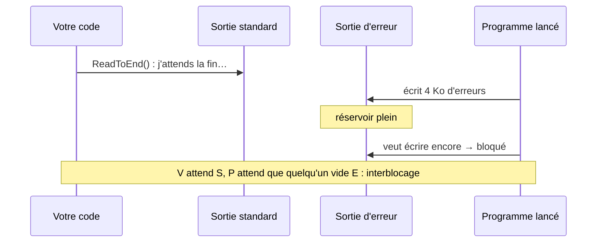

# 06 · Lancer une commande en une ligne : `Process.RunAndCaptureTextAsync` (.NET 11)

🇬🇧 [English version](../en/06-process.md)

> **En une phrase** : `await Process.RunAndCaptureTextAsync("git", ["status"])` lance un programme, attend sa fin et
> renvoie sa sortie standard, sa sortie d'erreur et son code de retour, sans aucun piège d'interblocage.
>
> Code : [`E06_Process.cs`](../../src/DotNet11Features.Examples/Examples/E06_Process.cs) ·
> Lancer : `dotnet run -c Release --project src/DotNet11Features.Examples -- process`

---

## 1. L'idée expliquée simplement

### L'image des deux tuyaux

Un programme lancé par le vôtre écrit dans **deux tuyaux** : la sortie standard (les résultats) et la sortie d'erreur
(les messages). Chaque tuyau a un **petit réservoir** (quelques Ko). Quand un réservoir est plein, le programme
s'arrête et **attend qu'on le vide**.

Le piège classique :

1. vous lisez la sortie standard jusqu'au bout (`ReadToEnd`) ;
2. pendant ce temps, le programme écrit beaucoup d'erreurs : le réservoir d'erreur se remplit ;
3. le programme attend que vous vidiez le réservoir d'erreur ;
4. vous attendez qu'il ferme la sortie standard.

Chacun attend l'autre : **interblocage**, le programme ne se termine jamais. La documentation de `Process` met en garde
contre ce cas depuis .NET Framework 1.0.



.NET 11 ajoute des méthodes qui font tout correctement : lire les deux tuyaux **en même temps**, attendre la fin,
gérer l'annulation.

---

## 2. Comment on faisait avant

La version **correcte** :

```csharp
var info = new ProcessStartInfo(program)
{
    RedirectStandardOutput = true,
    RedirectStandardError = true,
    UseShellExecute = false,
    CreateNoWindow = true,
    StandardOutputEncoding = Encoding.UTF8,
    StandardErrorEncoding = Encoding.UTF8,
};
foreach (var a in arguments) info.ArgumentList.Add(a);

using var process = Process.Start(info) ?? throw new InvalidOperationException(…);
Task<string> output = process.StandardOutput.ReadToEndAsync();   // les deux lectures en même temps
Task<string> errors = process.StandardError.ReadToEndAsync();
await process.WaitForExitAsync();
return (process.ExitCode, await output, await errors);
```

Et encore : l'annulation tue-t-elle le processus ? Non, `WaitForExitAsync(token)` arrête d'**attendre**, mais le
programme continue de tourner. Il faut ajouter un `try/catch` et un `process.Kill(entireProcessTree: true)`.

C'est pour ça que beaucoup de projets ajoutent une bibliothèque comme CliWrap ou SimpleExec.

---

## 3. Ce que change .NET 11

```csharp
ProcessTextOutput r = await Process.RunAndCaptureTextAsync("dotnet", ["--version"]);
r.StandardOutput            // "11.0.100\r\n"
r.StandardError             // ""
r.ExitStatus.ExitCode       // 0
r.ExitStatus.Canceled       // false
r.ProcessId
```

La famille complète :

| Méthode | Renvoie | Usage |
|---|---|---|
| `Process.Run(nom, args, silent, timeout)` | `ProcessExitStatus` | Lancer et attendre, sortie affichée (ou ignorée avec `silent: true`) |
| `Process.RunAsync(…, cancellationToken)` | `Task<ProcessExitStatus>` | Idem, asynchrone |
| `Process.RunAndCaptureText(nom, args, timeout)` | `ProcessTextOutput` | Lancer, attendre, **capturer** les deux sorties |
| `Process.RunAndCaptureTextAsync(…, cancellationToken)` | `Task<ProcessTextOutput>` | Idem, asynchrone |
| `Process.StartAndForget(…)` | | Lancer sans attendre ni garder de handle |

Chacune accepte aussi un `ProcessStartInfo` pour les réglages avancés (dossier de travail, variables
d'environnement…).

### Côte à côte

<table>
<tr><th>Avant</th><th>.NET 11</th></tr>
<tr><td valign="top">

```csharp
var info = new ProcessStartInfo("dotnet")
{
  RedirectStandardOutput = true,
  RedirectStandardError = true,
  UseShellExecute = false,
  CreateNoWindow = true,
};
info.ArgumentList.Add("--version");
using var p = Process.Start(info)!;
var o = p.StandardOutput.ReadToEndAsync();
var e = p.StandardError.ReadToEndAsync();
await p.WaitForExitAsync();
var (code, output) = (p.ExitCode, await o);
```

</td><td valign="top">

```csharp
var r = await Process
  .RunAndCaptureTextAsync(
    "dotnet", ["--version"]);

var (code, output) =
  (r.ExitStatus.ExitCode,
   r.StandardOutput);


```

</td></tr>
<tr><td>

**~14 lignes**, piège d'interblocage si on lit les flux l'un après l'autre.

</td><td>

**1 instruction**, lecture parallèle et annulation gérées.

</td></tr>
</table>

---

## 4. Sortie de l'exemple

```
── 06 · Process.RunAndCaptureTextAsync (.NET 11) ────────────
   ▸ After: one line
     code 0 · dotnet --version → 11.0.100 (pid 95876)
     ✓ same result as the version from before
   ▸ Standard error is captured separately, along with the exit code
     code 1 · Exécution impossible, car la commande ou le fichier spécifié est introuvable.
     ✓ a failure does not throw: read ExitStatus.ExitCode
   ▸ Cancellation: the process is stopped
     OperationCanceledException after 507 ms
     ✓ the 30 s process is stopped without waiting for it to end
   ▸ Synchronous version with a timeout: Process.Run
     dotnet --info (output discarded, silent: true) → code 0
     ✓ Process.Run returns the exit status directly
```

(Le message d'erreur vient de l'outil `dotnet` lui-même, dans la langue de la machine.)

---

## 5. Pièges et limites

1. **Un code de retour non nul n'est pas une exception.** Pensez à tester `ExitStatus.ExitCode` ; c'est voulu (beaucoup
   d'outils utilisent le code 1 pour « rien trouvé »).
2. **Annulation** : sous Windows avec SDK 11.0.100, l'annulation par jeton **lève `OperationCanceledException`** après
   avoir arrêté le processus (la commande de 30 s s'arrête bien en 0,5 s). La documentation évoque aussi
   `ExitStatus.Canceled` : l'exemple accepte les deux comportements.
3. **Tout est mis en mémoire.** Pour un programme qui produit des centaines de Mo, lisez en flux avec
   `ReadAllLinesAsync`, qui renvoie des `ProcessOutputLine` en distinguant sortie standard et erreur.
4. **Les arguments sont une liste**, pas une chaîne : pas de problème de guillemets ni d'espaces dans les chemins.
5. D'autres ajouts de .NET 11 autour des processus : `ProcessStartInfo.KillOnParentExit` (Windows),
   `StartSuspended` (Windows, macOS), `Process.Signal(PosixSignal.SIGTERM)` (Linux, macOS),
   `Process.TryGetProcessById`.

## Sources

- [What's new in .NET 11 libraries — Process](https://learn.microsoft.com/dotnet/core/whats-new/dotnet-11/libraries)
