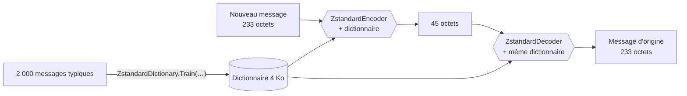

# 07 · Zstandard intégré à .NET 11

🇬🇧 [English version](../en/07-zstandard.md)

> **En une phrase** : `new ZstandardStream(stream, CompressionLevel.Optimal)` s'utilise exactement comme `GZipStream`,
> sans paquet NuGet, et ses **dictionnaires entraînés** compressent 4 fois mieux les petits messages.
>
> Code : [`E07_Zstandard.cs`](../../src/DotNet11Features.Examples/Examples/E07_Zstandard.cs) ·
> Lancer : `dotnet run -c Release --project src/DotNet11Features.Examples -- zstandard`

---

## 1. L'idée expliquée simplement

### Comment marche un compresseur

Un compresseur cherche les **répétitions** : au lieu d'écrire une deuxième fois `"Status":"shipped"`, il écrit
« recopier les 17 octets vus 340 octets plus tôt ». Plus il cherche longtemps et loin, plus il trouve de
répétitions, mais plus il est lent. C'est le réglage de **niveau** (ou de qualité).

| Algorithme | Né en | Point fort |
|---|---|---|
| GZip / Deflate | 1992 | Universel, lisible partout |
| Brotli | 2015 (Google) | Très bon ratio sur le texte web, décompression rapide |
| **Zstandard** (zstd) | 2016 (Facebook) | Très **rapide** aux niveaux bas, **excellent ratio** aux niveaux hauts, et des **dictionnaires** |

Zstandard est devenu un standard de fait : noyau Linux, paquets Arch et Fedora, Kafka, bases de données, HTTP
(`Content-Encoding: zstd` dans Chrome et Firefox).

### Le dictionnaire : pourquoi les petits messages se compressent mal

Un message JSON de 233 octets contient trop peu de répétitions **à l'intérieur de lui-même** : GZip le réduit à peine
(×1,3). Pourtant, les 1 000 messages d'une file se ressemblent tous : mêmes noms de propriétés, mêmes valeurs
fréquentes.

Un **dictionnaire** est un petit bloc d'octets (ici 4 Ko) **appris** sur des messages typiques. Compresseur et
décompresseur le partagent : chaque message peut alors dire « recopier ces 17 octets **du dictionnaire** ».



---

## 2. Comment on faisait avant

- **GZip ou Brotli**, intégrés à .NET : pas de dictionnaire, et GZip est lent à ses meilleurs niveaux.
- **Zstandard via un paquet tiers** (ZstdSharp, ZstdNet…) : une dépendance de plus, et souvent une **DLL native**
  à embarquer pour chaque plateforme (Windows x64, Linux arm64…), avec ses soucis de déploiement.

---

## 3. Ce que change .NET 11

`System.IO.Compression` contient maintenant :

| Type | Rôle |
|---|---|
| `ZstandardStream` | Flux de compression / décompression, même usage que `GZipStream` |
| `ZstandardEncoder` / `ZstandardDecoder` | API sans flux, sur des `Span<byte>`, avec `TryCompress` / `TryDecompress` en une ligne |
| `ZstandardCompressionOptions` | Qualité (1 à 22), taille de fenêtre, somme de contrôle, dictionnaire… |
| `ZstandardDictionary` | `Train(…)` pour apprendre un dictionnaire, `Create(…)` pour le charger |

```csharp
// Comme GZip : seul le nom du type change
using (var stream = new ZstandardStream(output, CompressionLevel.Optimal)) stream.Write(data);

// Qualité précise
new ZstandardStream(output, new ZstandardCompressionOptions { Quality = 19 }, leaveOpen: false);

// Dictionnaire
byte[] dictData = ZstandardDictionary.Train(samples, lengths, maxDictionarySize: 4096);
using ZstandardDictionary dict = ZstandardDictionary.Create(dictData, quality: 19);
ZstandardEncoder.TryCompress(message, buffer, out int written, dict, ZstandardCompressionOptions.DefaultWindowLog2);
ZstandardDecoder.TryDecompress(compressed, readBack, out int read, dict);
```

---

## 4. Résultats mesurés

Démo `zstandard`, 20 000 commandes en JSON (4,5 Mo), AMD Ryzen 7 9800X3D, Windows 11, .NET 11.0.0, moyenne de
5 passages après préchauffage. Les durées varient de ±10 % d'un lancement à l'autre ; tailles et ratios sont exacts.

| Algorithme | Taille | Ratio | Compression | Décompression |
|---|---:|---:|---:|---:|
| GZip (Optimal) | 338 Ko | 13,5× | 20,2 ms | 3,5 ms |
| GZip (SmallestSize) | 316 Ko | 14,4× | 57,0 ms | 3,2 ms |
| Brotli (Optimal) | 395 Ko | 11,5× | 14,7 ms | 4,5 ms |
| **Zstandard (Optimal)** | 434 Ko | 10,5× | **4,3 ms** | 3,2 ms |
| Zstandard (qualité 6) | 345 Ko | 13,2× | 19,2 ms | 3,3 ms |
| Zstandard (qualité 9) | 319 Ko | 14,3× | 30,6 ms | 3,6 ms |
| Zstandard (qualité 12) | 302 Ko | 15,1× | 75,6 ms | 3,2 ms |
| **Zstandard (qualité 19)** | **249 Ko** | **18,3×** | 1 521 ms | 3,3 ms |

**1 000 petits messages JSON** (233 octets en moyenne), compressés un par un :

| Méthode | Octets par message | Ratio |
|---|---:|---:|
| GZip | 176 | 1,3× |
| Zstandard sans dictionnaire | 164 | 1,4× |
| **Zstandard avec dictionnaire de 4 Ko** | **45** | **5,1×** |

### Benchmarks (BenchmarkDotNet, job court)

| Compression de 4,5 Mo | Temps | Ratio de temps |
|---|---:|---:|
| GZip (Optimal) | 20,1 ms | 1,00 |
| Brotli (Optimal) | 13,7 ms | 0,68 |
| **Zstandard (Optimal)** | **4,1 ms** | **0,20** |
| Zstandard (qualité 9) | 29,2 ms | 1,45 |

| 1 000 petits messages | Temps | |
|---|---:|---|
| Zstandard sans dictionnaire | 3,81 ms | |
| **Zstandard avec dictionnaire** | **1,96 ms** | **1,9× plus rapide**, en plus d'être 4× plus petit |

Le dictionnaire accélère aussi la compression : le compresseur trouve tout de suite les répétitions dans le
dictionnaire au lieu de les chercher dans un message trop court pour en contenir.

### Comment lire ces chiffres

- **Le réglage `Optimal` n'a pas le même sens partout.** Pour Zstandard, c'est son niveau par défaut (3) : **5 fois
  plus rapide que GZip `Optimal`** mais un fichier 28 % plus gros. Pour obtenir la taille de GZip, il faut la
  qualité 6, et on retrouve alors à peu près le même temps.
- **Le GZip de .NET est rapide** : depuis .NET 9, il s'appuie sur zlib-ng. L'écart de vitesse avec Zstandard à taille
  égale est donc faible sur ce jeu de données ; ne comptez pas sur un gain « magique » en changeant juste d'algorithme.
- **Les deux vrais atouts de Zstandard** :
  1. **l'éventail des réglages** : de la compression quasi gratuite (4 ms pour 4,5 Mo, utile pour des journaux ou
     un cache) jusqu'à −26 % de taille par rapport à GZip pour des archives qu'on compresse une fois et qu'on lit
     souvent ;
  2. **la décompression ne dépend pas du niveau** : environ 3 ms que le fichier ait été compressé en qualité 3 ou 19.
- **Le dictionnaire est la fonctionnalité décisive pour les petits messages** (files de messages, cache distribué,
  lignes de base de données, télémétrie) : 4 fois plus petit que sans dictionnaire, là où GZip ne gagne presque rien.

---

## 5. Pièges et limites

1. **Le dictionnaire doit être le même des deux côtés**, à l'octet près. Versionnez-le (stockez son identifiant avec
   les données) : un message compressé avec le dictionnaire v1 est illisible avec le v2.
2. **Entraînez sur des données représentatives**, et différentes de celles que vous mesurez : l'exemple entraîne sur
   une graine aléatoire et teste sur une autre.
3. **Les qualités au-delà de 19** (jusqu'à 22) demandent beaucoup de mémoire et de temps : réservez-les aux archives.
4. **Compatibilité** : un fichier `.zst` produit par .NET se lit avec l'outil `zstd` en ligne de commande, et
   inversement (format standard, RFC 8878).
5. Autres ajouts compression de .NET 11 : codecs sur spans `ZLibEncoder`, `GZipEncoder`, `DeflateEncoder` (et leurs
   décodeurs), `ZipArchiveEntry.Open(FileAccess)`, mots de passe ZIP, format GNU/Ustar pour `TarFile`.

## Sources

- [What's new in .NET 11 libraries — Compression](https://learn.microsoft.com/dotnet/core/whats-new/dotnet-11/libraries)
- [RFC 8878 — Zstandard Compression](https://www.rfc-editor.org/rfc/rfc8878)
