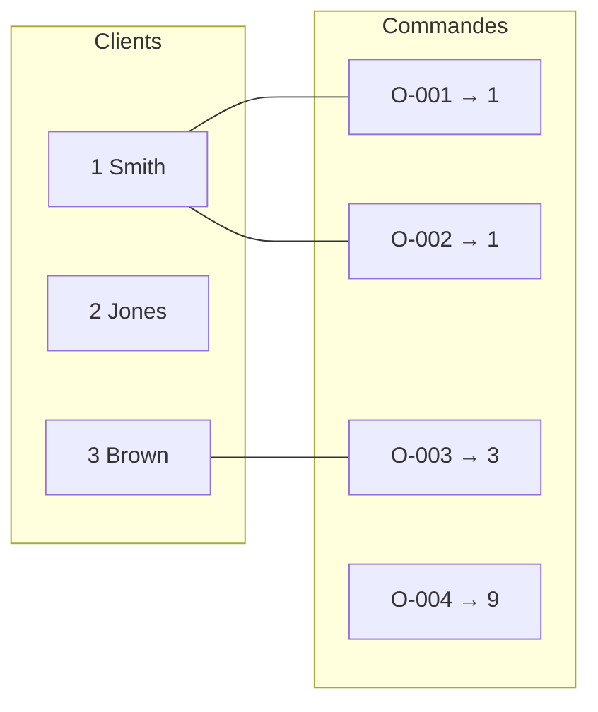

# 08 · LINQ : `FullJoin` et jointures sans sélecteur (.NET 11)

🇬🇧 [English version](../en/08-linq-joins.md)

> **En une phrase** : `catalog.FullJoin(stock, a => a.Sku, s => s.Sku)` fait enfin la jointure externe complète,
> et toutes les jointures acceptent maintenant d'être appelées **sans sélecteur de résultat** : elles renvoient des
> tuples qu'on déconstruit directement.
>
> Code : [`E08_LinqJoins.cs`](../../src/DotNet11Features.Examples/Examples/E08_LinqJoins.cs) ·
> Lancer : `dotnet run -c Release --project src/DotNet11Features.Examples -- joins`

**Ce qui est nouveau, exactement** (vérifié dans les assemblies de référence de .NET 10 et 11) :

| Méthode | Apparue en |
|---|---|
| `LeftJoin(…, resultSelector)`, `RightJoin(…, resultSelector)` | .NET 10 |
| **`FullJoin`** (avec ou sans sélecteur) | **.NET 11** |
| **`Join`, `GroupJoin`, `LeftJoin`, `RightJoin` sans sélecteur** (renvoient des tuples), comparateur optionnel | **.NET 11** |

---

## 1. L'idée expliquée simplement

Une **jointure** associe les éléments de deux listes qui partagent une clé : chaque commande avec son client.



Jones n'a pas de commande, la commande O-004 n'a pas de client (le client 9 n'existe pas). Selon la question posée,
on veut garder ou non ces orphelins :

| Jointure | Garde | Question métier | SQL | LINQ |
|---|---|---|---|---|
| Interne | les paires seulement | « commandes avec leur client » | `INNER JOIN` | `Join` |
| Externe gauche | + clients sans commande | « tous les clients, et leurs commandes s'ils en ont » | `LEFT JOIN` | `LeftJoin` (.NET 10) |
| Externe droite | + commandes sans client | « toutes les commandes, même orphelines » | `RIGHT JOIN` | `RightJoin` (.NET 10) |
| Externe complète | + les deux | « rapprocher deux sources et lister les écarts » | `FULL OUTER JOIN` | **`FullJoin` (.NET 11)** |

---

## 2. Comment on faisait avant

Jusqu'à .NET 9, la jointure externe gauche s'écrivait ainsi :

```csharp
var result = Customers
    .GroupJoin(Orders, c => c.Id, o => o.CustomerId, (customer, orders) => new { customer, orders })
    .SelectMany(x => x.orders.DefaultIfEmpty(), (x, o) => (x.customer.Name, Number: o?.Number ?? "(none)"));
```

.NET 10 a ajouté `LeftJoin` et `RightJoin`, mais **toujours avec un sélecteur de résultat obligatoire** :

```csharp
Customers.LeftJoin(Orders, c => c.Id, o => o.CustomerId, (customer, order) => (customer, order));
//                                                       ^^^^^^^^^^^^^^^^^^^^^^^^^^^^^^^^^^^^^^ juste pour faire un tuple
```

Et la jointure **complète** n'existait toujours pas : jointure gauche, puis ajout des orphelins de droite en vérifiant
qu'ils n'ont pas de correspondance.

```csharp
var full = Catalog
    .GroupJoin(Stock, a => a.Sku, s => s.Sku, (a, s) => new { a, s })
    .SelectMany(x => x.s.DefaultIfEmpty(), (x, s) => (x.a.Sku, Item: (CatalogItem?)x.a, Stock: s))
    .Concat(Stock.Where(s => !Catalog.Any(a => a.Sku == s.Sku))
                 .Select(s => (s.Sku, Item: (CatalogItem?)null, Stock: (WarehouseStock?)s)));
```

---

## 3. Ce que change .NET 11

```csharp
// FullJoin : les deux côtés peuvent être null
foreach (var (item, stock) in Catalog.FullJoin(Stock, a => a.Sku, s => s.Sku)) …

// Toutes les jointures sans sélecteur : des tuples (Outer, Inner) à déconstruire
foreach (var (customer, order) in Customers.LeftJoin(Orders, c => c.Id, o => o.CustomerId)) …
foreach (var (customer, order) in Customers.RightJoin(Orders, c => c.Id, o => o.CustomerId)) …

// Un comparateur de clés en paramètre optionnel
Catalog.Join(stock, a => a.Sku, s => s.Sku, StringComparer.OrdinalIgnoreCase);
```

Le `FullJoin` se marie très bien avec un `switch` sur le tuple :

```csharp
string diagnosis = (item, stock) switch
{
    (not null, not null) => $"OK, {stock.Quantity} in stock",
    (not null, null)     => "in the catalog but never received in the warehouse",
    (null, not null)     => "in the warehouse but missing from the catalog!",
    (null, null)         => "impossible",
};
```

Ces opérateurs existent pour `Enumerable`, `Queryable` et `AsyncEnumerable`.

### Côte à côte

<table>
<tr><th>Avant</th><th>.NET 11</th></tr>
<tr><td valign="top">

```csharp
Catalog
  .GroupJoin(Stock,
    a => a.Sku, s => s.Sku,
    (a, s) => new { a, s })
  .SelectMany(
    x => x.s.DefaultIfEmpty(),
    (x, s) => (x.a, s))
  .Concat(Stock
    .Where(s => !Catalog
      .Any(a => a.Sku == s.Sku))
    .Select(s => (null, s)));
```

</td><td valign="top">

```csharp
Catalog
  .FullJoin(Stock,
    a => a.Sku, s => s.Sku);


```

</td></tr>
</table>

---

## 4. Résultats

### Sortie de l'exemple

```
   ▸ .NET 11: Catalog.FullJoin(Stock, a => a.Sku, s => s.Sku)
     COFFEE  OK, 120 in stock
     TEA     in the catalog but never received in the warehouse
     MUG     OK, 8 in stock
     FILTER  in the warehouse but missing from the catalog!
     ✓ 4 rows: COFFEE, TEA, MUG and FILTER, like the manual version
```

### Benchmarks (BenchmarkDotNet, 10 000 clients × 30 000 commandes, job court)

| Méthode | Temps | Mémoire |
|---|---:|---:|
| Avant .NET 10 : GroupJoin + SelectMany + DefaultIfEmpty | 2,26 ms | 3,96 Mo |
| .NET 10 : LeftJoin | 2,14 ms | 2,84 Mo (−28 %) |
| Avant : jointure complète manuelle (avec un `HashSet` des clés) | 1,70 ms | 4,48 Mo |
| **.NET 11 : FullJoin** | 3,44 ms (**×2,0**) | 3,49 Mo (−22 %) |

### Comment lire ces chiffres

- **`FullJoin` est plus lent qu'une version manuelle bien écrite** sur ce cas (un tiers des commandes sont
  orphelines). Il reste bien plus simple, alloue moins, et la version manuelle « naïve » de la démo (un `Any()` par
  élément au lieu d'un `HashSet`) serait, elle, quadratique. Sur un chemin critique avec de gros volumes, mesurez.
- **`LeftJoin` vaut l'ancienne incantation en vitesse** et alloue 28 % de moins.
- Avec un fournisseur `IQueryable` (Entity Framework Core…), c'est la base de données qui fait la jointure : la
  question des performances se pose côté SQL, à condition que le fournisseur sache traduire l'opérateur.

---

## 5. Pièges et limites

1. **Le côté manquant vaut `default`** : `null` pour une classe, mais `0` ou `default(T)` pour un struct ou un
   tuple. Pour distinguer « absent » de « valeur nulle », utilisez des types référence ou `Nullable<T>`.
2. **L'ordre** : `LeftJoin` garde l'ordre de la séquence de gauche ; `FullJoin` renvoie d'abord les éléments de
   gauche (associés ou non), puis les orphelins de droite.
3. **Doublons de clé** : comme en SQL, un client avec deux commandes produit deux lignes.

## Sources

- [What's new in .NET 11 libraries — LINQ](https://learn.microsoft.com/dotnet/core/whats-new/dotnet-11/libraries)
- [What's new in .NET 10 libraries — LeftJoin et RightJoin](https://learn.microsoft.com/dotnet/core/whats-new/dotnet-10/libraries)
