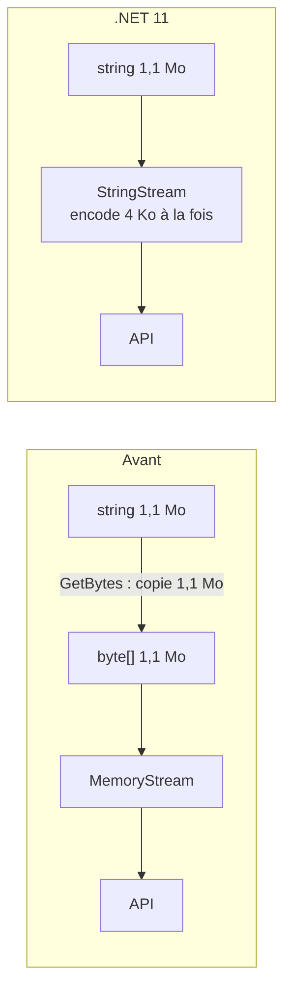

# 09 · Nouveaux types `Stream` : `StringStream`, `ReadOnlyMemoryStream`, `WritableMemoryStream`, `ReadOnlySequenceStream` (.NET 11)

🇬🇧 [English version](../en/09-streams.md)

> **En une phrase** : quatre flux qui présentent une chaîne, une zone mémoire ou une séquence Pipelines comme un
> `Stream`, **sans recopier les données**.
>
> Code : [`E09_Streams.cs`](../../src/DotNet11Features.Examples/Examples/E09_Streams.cs) ·
> Lancer : `dotnet run -c Release --project src/DotNet11Features.Examples -- streams`

---

## 1. L'idée expliquée simplement

### L'image du robinet

Un `Stream` est un **robinet** : on tire des octets au fur et à mesure, sans savoir d'où ils viennent (fichier,
réseau, mémoire). Énormément d'API .NET demandent un robinet : `JsonSerializer.Deserialize(Stream)`,
`XmlReader.Create(Stream)`, `HttpContent`, les compresseurs, les API de stockage cloud…

Problème : vos données ne sont pas toujours dans un **seau** compatible. Avant .NET 11, le seul « robinet sur de la
mémoire » était `MemoryStream`, qui n'accepte qu'un `byte[]`. Si vos données étaient :

- une **chaîne** (`string`, donc des caractères, pas des octets) ;
- une **tranche** d'un tampon (`ReadOnlyMemory<byte>`, souvent issue d'un pool) ;
- une **séquence en morceaux** (`ReadOnlySequence<byte>`, ce que renvoie System.IO.Pipelines) ;

… il fallait d'abord **tout transvaser** dans un nouveau `byte[]`. Pour 1 Mo de données, 1 Mo de copie.

| Vos données | Avant .NET 11 | .NET 11 |
|---|---|---|
| `string` | `new MemoryStream(Encoding.UTF8.GetBytes(s))` | `new StringStream(s, Encoding.UTF8)` |
| `ReadOnlyMemory<byte>` | `new MemoryStream(m.ToArray())` | `new ReadOnlyMemoryStream(m)` |
| `Memory<byte>` (pour écrire) | `MemoryStream` qui grossit tout seul | `new WritableMemoryStream(m)` (taille fixe) |
| `ReadOnlySequence<byte>` | `new MemoryStream(seq.ToArray())` | `new ReadOnlySequenceStream(seq)` |



---

## 2. Comment on faisait avant

```csharp
// Une chaîne JSON reçue d'ailleurs, à passer à une API qui attend un Stream
using var stream = new MemoryStream(Encoding.UTF8.GetBytes(json));       // copie complète

// Une tranche d'un tampon plus grand
using var stream2 = new MemoryStream(slice.ToArray());                  // copie de la tranche

// Une séquence Pipelines
using var stream3 = new MemoryStream(sequence.ToArray());               // aplatie en un seul tableau
```

Beaucoup de projets avaient leur propre `ReadOnlyMemoryStream` ou `StringStream` maison (ASP.NET Core en contient
plusieurs en interne), avec chacun ses bogues sur `Seek` ou `ReadAsync`.

---

## 3. Ce que change .NET 11

```csharp
using var stream = new StringStream(json, Encoding.UTF8);              // encode au fil de la lecture
var orders = JsonSerializer.Deserialize<List<Order>>(stream);

using var stream2 = new ReadOnlyMemoryStream(slice);                    // lecture seule, aucune copie

using var output = new WritableMemoryStream(rentedBuffer.AsMemory(0, 256));   // écrit dans VOTRE tampon
JsonSerializer.Serialize(output, value);

using var stream3 = new ReadOnlySequenceStream(sequence);               // lit segment par segment
```

---

## 4. Résultats

### Sortie de l'exemple (mémoire allouée pour lire tout le flux)

```
     A 1,145 K-character JSON string to pass to an API that expects a Stream
   ▸ Before: new MemoryStream(Encoding.UTF8.GetBytes(text)) → full copy as bytes
     memory allocated:    1,146 KB
   ▸ After: new StringStream(text, Encoding.UTF8) → encoded as it is read
     memory allocated:        0 KB
   ▸ Before: MemoryStream requires a byte[] → ToArray() on a ReadOnlyMemory<byte> = a copy
     memory allocated:       98 KB
   ▸ After: new ReadOnlyMemoryStream(slice) → no copy, read-only
     memory allocated:        0 KB
   ▸ WritableMemoryStream: write into a rented buffer that never grows
     42 bytes written into the rented buffer: {"Number":"ORD-2026-000042","Amount":42.5}
     ✓ going past the capacity throws NotSupportedException (a MemoryStream would have reallocated)
   ▸ ReadOnlySequenceStream: read a ReadOnlySequence<byte> (Pipelines) without flattening it
     1,145 KB sequence in 287 segments
     before, sequence.ToArray() + MemoryStream:    1,146 KB
     after, new ReadOnlySequenceStream(seq):           0 KB
```

### Benchmark : désérialiser 5 000 commandes (1,1 Mo de JSON) depuis une chaîne

| Méthode | Temps | Mémoire |
|---|---:|---:|
| Avant : `MemoryStream(Encoding.UTF8.GetBytes(json))` | 5,73 ms | 5,45 Mo |
| **Après : `StringStream(json, Encoding.UTF8)`** | **4,13 ms (−28 %)** | **4,33 Mo (−21 %)** |

### Comment lire ces chiffres

- Le gain mémoire **exact** est la taille des données : 1,1 Mo de moins par appel. Le reste des 4,3 Mo, ce sont les
  objets désérialisés eux-mêmes.
- Le gain de temps vient surtout du **ramasse-miettes** : un tableau de 1,1 Mo va dans le tas des gros objets (LOH,
  au-delà de 85 Ko), coûteux à collecter. Le benchmark montre 242 collectes de génération 2 pour 1 000 appels avant,
  **aucune** après.

---

## 5. Pièges et limites

1. **`StringStream` n'est pas cherchable** (`CanSeek` vaut `false`) : sa position en octets dépend de l'encodage. Une
   API qui a besoin de `Length` ou de revenir en arrière demande toujours un `MemoryStream`.
2. **`ReadOnlyMemoryStream` ne garde pas le tampon en vie au-delà de votre code** : si ce tampon vient d'un
   `ArrayPool`, ne le rendez pas au pool tant que le flux est utilisé.
3. **`WritableMemoryStream` a une taille fixe** : écrire au-delà lève `NotSupportedException`. C'est le but (pas de
   réallocation surprise), mais il faut dimensionner le tampon.
4. Ces types sont dans `System.IO` (CoreLib) : aucun paquet à ajouter.

## Sources

- [What's new in .NET 11 libraries — Stream types](https://learn.microsoft.com/dotnet/core/whats-new/dotnet-11/libraries)
