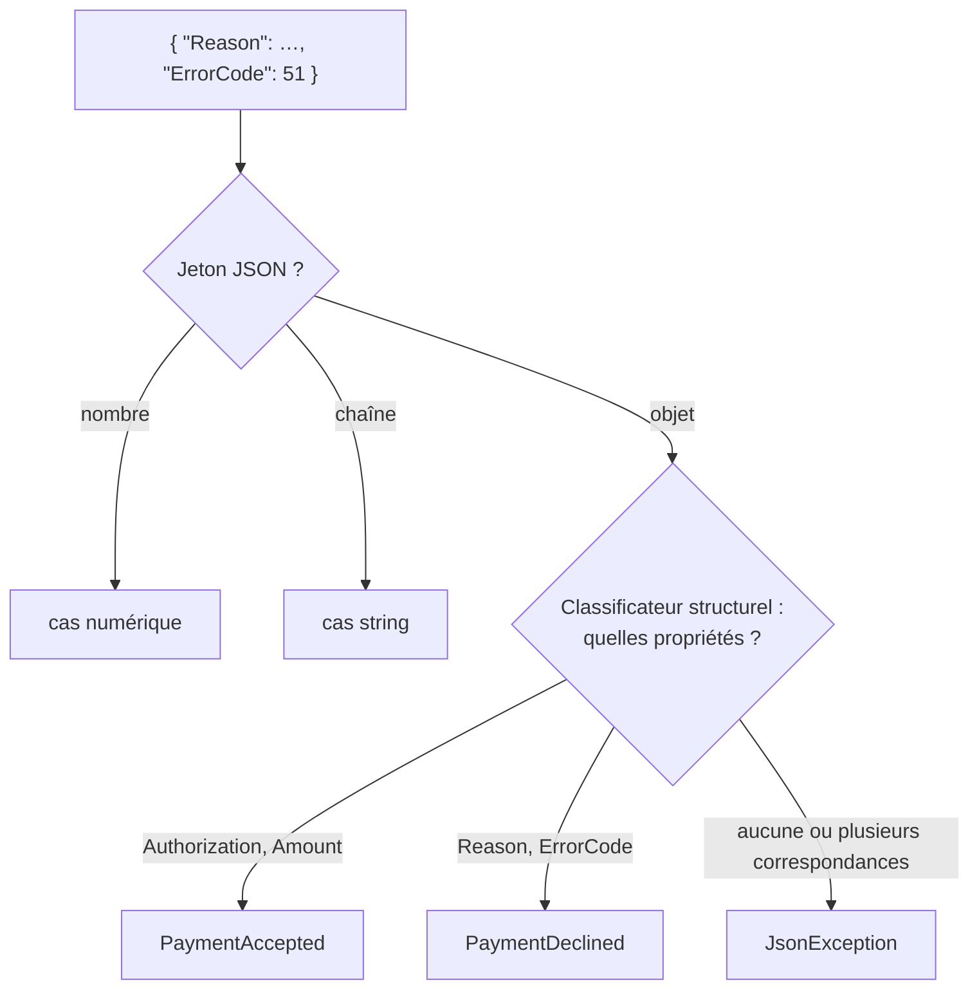

# 10 · System.Text.Json : unions, hiérarchies fermées, nommage par type (.NET 11)

🇬🇧 [English version](../en/10-json-unions.md)

> **En une phrase** : System.Text.Json sait sérialiser les [unions](01-unions.md) de C# 15, deviner le cas d'un objet
> JSON d'après ses propriétés, déduire le polymorphisme d'une [hiérarchie fermée](02-hierarchies-fermees.md), et
> appliquer une politique de nommage à un seul type.
>
> Code : [`E10_JsonUnions.cs`](../../src/DotNet11Features.Examples/Examples/E10_JsonUnions.cs) ·
> Lancer : `dotnet run -c Release --project src/DotNet11Features.Examples -- json`

---

## 1. L'idée expliquée simplement

Un prestataire de paiement vous répond **soit** `{"Authorization":"A1B2C3","Amount":42.5}`, **soit**
`{"Reason":"Insufficient funds","ErrorCode":51}`. Il n'y a **pas de champ « type »** : c'est la forme de l'objet
qui dit ce que c'est. C'est très courant dans les API qu'on ne maîtrise pas.

Pour désérialiser ça, il faut **regarder les propriétés présentes** avant de choisir la classe. Jusqu'ici,
System.Text.Json ne savait faire du polymorphisme qu'avec un discriminant explicite (`"$type": "…"`).

.NET 11 apporte :

| Besoin | Avant | .NET 11 |
|---|---|---|
| Choisir le type d'après la forme du JSON | `JsonConverter` maison | `union` + `JsonUnionTypeStructuralClassifier` |
| Union de valeurs simples (`double` ou `string`) | `JsonConverter` maison | `union Reading(double, string)`, rien à configurer |
| Polymorphisme d'une hiérarchie | un `[JsonDerivedType]` par classe | `closed` + `InferClosedTypePolymorphism = true` |
| snake_case pour un seul type | un `[JsonPropertyName]` par propriété | `[JsonNamingPolicy(SnakeCaseLower)]` sur le type |
| PascalCase global | politique maison | `JsonNamingPolicy.PascalCase` |

---

## 2. Comment on faisait avant

```csharp
public sealed class PaymentResponseConverterBefore : JsonConverter<object>
{
    public override object Read(ref Utf8JsonReader reader, Type type, JsonSerializerOptions options)
    {
        using var doc = JsonDocument.ParseValue(ref reader);                   // lit tout l'objet en mémoire
        if (doc.RootElement.TryGetProperty("Authorization", out _)) return doc.RootElement.Deserialize<PaymentAccepted>(options)!;
        if (doc.RootElement.TryGetProperty("Reason", out _)) return doc.RootElement.Deserialize<PaymentDeclined>(options)!;
        throw new JsonException("Unknown payment response");
    }

    public override void Write(Utf8JsonWriter writer, object value, JsonSerializerOptions options) =>
        JsonSerializer.Serialize(writer, value, value.GetType(), options);
}
```

Et pour une hiérarchie, la liste à tenir à jour :

```csharp
[JsonPolymorphic]
[JsonDerivedType(typeof(PercentDiscountBefore), "PercentDiscountBefore")]
[JsonDerivedType(typeof(AmountDiscountBefore), "AmountDiscountBefore")]   // oublier une ligne = exception à l'exécution
public abstract record DiscountBefore;
```

---

## 3. Ce que change .NET 11

```csharp
[JsonUnion(TypeClassifier = typeof(JsonUnionTypeStructuralClassifier))]
public union PaymentResponse(PaymentAccepted, PaymentDeclined);

PaymentResponse r = JsonSerializer.Deserialize<PaymentResponse>(json);
string text = r switch
{
    PaymentAccepted a => $"accepted, authorization {a.Authorization}",
    PaymentDeclined d => $"declined ({d.ErrorCode}): {d.Reason}",
};
```

Le **classificateur structurel** compare les noms de propriétés présents dans l'objet JSON avec ceux de chaque cas.
Zéro ou plusieurs correspondances : `JsonException`.



```csharp
[JsonPolymorphic(InferClosedTypePolymorphism = true)]
public closed record Discount;                // les dérivées sont trouvées dans les métadonnées de « closed »
public record PercentDiscount(int Percent) : Discount;
public record AmountDiscount(decimal Amount) : Discount;

[JsonNamingPolicy(JsonKnownNamingPolicy.SnakeCaseLower)]
public record Webhook(string EventId, DateTimeOffset CreatedAt, long AmountCents);
```

---

## 4. Sortie de l'exemple

```
   ▸ Union of simple values: written as is, with no wrapper and no $type
     [21.5,"sensor offline"]
   ▸ After: [JsonUnion(TypeClassifier = typeof(JsonUnionTypeStructuralClassifier))]
     {"Authorization":"A1B2C3","Amount":42.5}                → accepted, authorization A1B2C3 for 42.5 €
     {"Reason":"Insufficient funds","ErrorCode":51}          → declined (51): Insufficient funds
     ✓ the case is picked from the property names present
     ✓ an object that matches no case throws JsonException
   ▸ Closed hierarchy: InferClosedTypePolymorphism replaces the list of [JsonDerivedType]
     before: [{"$type":"PercentDiscountBefore","Percent":10},{"$type":"AmountDiscountBefore","Amount":5}]
     after:  [{"$type":"PercentDiscount","Percent":10},{"$type":"AmountDiscount","Amount":5}]
   ▸ Type-level naming policy: [JsonNamingPolicy(SnakeCaseLower)]
     before (3 attributes): {"event_id":"evt_42","created_at":"2026-11-10T09:00:00+00:00","amount_cents":4250}
     after (1 attribute):   {"event_id":"evt_42","created_at":"2026-11-10T09:00:00+00:00","amount_cents":4250}
   ▸ And the new global JsonNamingPolicy.PascalCase
     {"OrderNumber":"O-001","TotalAmount":42.5}
```

Le polymorphisme déduit utilise **le nom de la classe** comme discriminant (`"$type":"PercentDiscount"`).

---

## 5. Pièges et limites

1. **Deux cas de même forme JSON sont ambigus.** `union CustomerId(int, Guid, string)` se sérialise bien, mais se
   **désérialise** mal : un `Guid` et un `string` sont tous deux des chaînes JSON. Erreur obtenue en le testant :
   ```
   JsonException: JSON value type 'String' is ambiguous for union type 'CustomerId' because multiple case
   types can use this value type. Specify a custom type classifier to support deserialization.
   ```
   Solution : un classificateur maison (`JsonTypeClassifierFactory`), ou éviter ce mélange dans une union destinée au JSON.
2. **Le classificateur structurel** ne gère pas les unions imbriquées, les cas eux-mêmes polymorphes, ni
   `ReferenceHandler.Preserve`.
3. **Renommer une classe change le JSON** quand le discriminant est déduit (`$type` = nom de la classe). Pour un
   contrat public stable, gardez des `[JsonDerivedType(typeof(X), "nom-stable")]` explicites : ils remplacent la liste
   déduite.
4. **Priorité des règles de nommage** : `[JsonPropertyName]` > `[JsonNamingPolicy]` sur la propriété >
   `[JsonNamingPolicy]` sur le type > `JsonSerializerOptions.PropertyNamingPolicy` > nom C#.
5. **Applications en un fichier et Native AOT** : la sérialisation par réflexion y est désactivée par défaut ; il faut
   un `JsonSerializerContext` (générateur de source) ou `#:property PublishAot=false`.

## Sources

- [What's new in .NET 11 libraries — System.Text.Json](https://learn.microsoft.com/dotnet/core/whats-new/dotnet-11/libraries)
