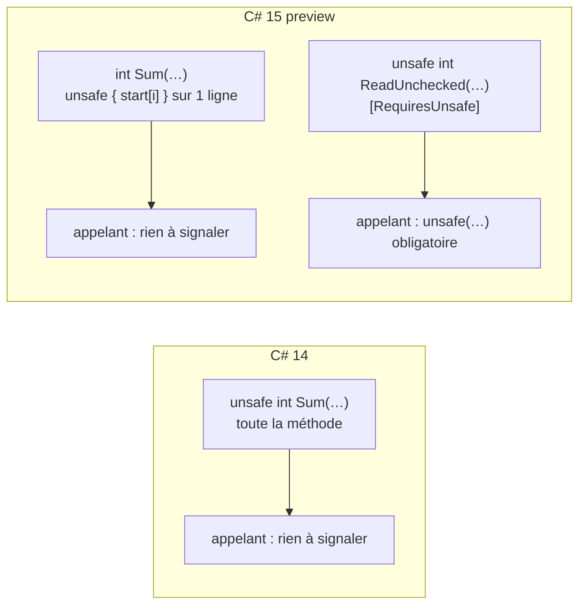

# 15 · Nouveau modèle de sécurité mémoire (C# 15, **preview**)

🇬🇧 [English version](../en/15-memory-safety.md)

> **En une phrase** : déclarer un pointeur, prendre une adresse ou utiliser `fixed` ne demandent plus `unsafe` ;
> seul le **déréférencement** est dangereux et doit être marqué, au plus près, avec `unsafe { }` ou `unsafe(expr)`.
> Et `unsafe` sur une méthode signifie désormais « **l'appelant** doit l'assumer ».
>
> Code : [`src/DotNet11Features.MemorySafety/Program.cs`](../../src/DotNet11Features.MemorySafety/Program.cs) ·
> Lancer : `dotnet run -c Release --project src/DotNet11Features.MemorySafety`

> ⚠️ **Fonctionnalité en preview dans .NET 11.** Elle demande trois réglages, d'où un projet séparé : le reste de la
> solution reste en C# 15 stable. Syntaxe et règles peuvent encore changer en .NET 12.

```xml
<PropertyGroup>
  <LangVersion>preview</LangVersion>
  <Features>$(Features);updated-memory-safety-rules</Features>
  <AllowUnsafeBlocks>true</AllowUnsafeBlocks>
</PropertyGroup>
```

---

## 1. L'idée expliquée simplement

### Qu'est-ce qui est vraiment dangereux avec un pointeur ?

Un pointeur est une **adresse** : « la case mémoire n° 0x7FF6… ». Avoir une adresse dans une variable ne fait de mal à
personne. Ce qui est dangereux, c'est d'**aller lire ou écrire à cette adresse** sans vérification : si elle est
fausse (hors du tableau, objet libéré), on lit n'importe quoi ou on écrase la mémoire d'autre chose.

| Opération | Exemple | Dangereuse ? |
|---|---|---|
| Déclarer un pointeur | `int* p;` | non |
| Prendre une adresse | `&value` | non |
| Épingler un tableau | `fixed (int* p = array)` | non |
| Taille d'un type | `sizeof(MyStruct)` | non |
| **Lire / écrire à l'adresse** | `*p`, `p[i]`, `p->x` | **oui** |
| **Appeler un pointeur de fonction** | `fn(…)` | **oui** |

Jusqu'à C# 14, **toutes** ces opérations exigeaient un contexte `unsafe`. Résultat : on marque une méthode entière
`unsafe`, et un relecteur ne sait plus quelle ligne mérite son attention.

### Le parallèle avec Rust

C'est exactement le modèle de Rust : `unsafe { }` autour des seules opérations dangereuses, et `unsafe fn` pour une
fonction dont l'**appelant** doit garantir des conditions (« l'index est dans le tableau »).

---

## 2. Comment on faisait avant (C# 14)

```csharp
public static unsafe int SumBefore(int[] values)        // toute la méthode est unsafe
{
    int total = 0;
    fixed (int* start = values)
    {
        for (int i = 0; i < values.Length; i++) total += start[i];
    }
    return total;
}

int s = Calculations.SumBefore(readings);               // l'appelant ne voit rien
```

Ce même code, compilé avec les nouvelles règles, **ne compile plus** (erreurs relevées en écrivant l'exemple) :

```
error CS9360: Cette opération ne peut être utilisée que dans un contexte non sécurisé       ← start[i]
error CS9362: « Calculations.SumBefore(int[]) » doit être utilisé dans un contexte non sécurisé,
              car il est marqué comme « unsafe »                                          ← chez l'appelant
```

Deux changements de sens apparaissent :

1. `unsafe` sur une méthode **ne rend plus son corps unsafe** : `start[i]` doit être marqué lui-même.
2. `unsafe` sur une méthode **impose un contexte unsafe à l'appelant**.

---

## 3. Ce que change C# 15 (preview)

```csharp
public static int Sum(int[] values)                      // méthode ordinaire
{
    int total = 0;
    fixed (int* start = values)                          // sûr : épingler et prendre l'adresse
    {
        for (int i = 0; i < values.Length; i++)
        {
            unsafe { total += start[i]; }                // ← la seule ligne à relire avec attention
        }
    }
    return total;
}

public static byte FirstByte(int value)
{
    int* address = &value;                               // sûr
    byte* b = (byte*)address;                            // sûr
    return unsafe(*b);                                   // nouvelle expression unsafe(…)
}

/// <remarks>Safety: the caller guarantees that index is inside the pointed array.</remarks>
public static unsafe int ReadUnchecked(int* values, int index) => unsafe(values[index]);

// Côté appelant :
// Calculations.ReadUnchecked(p, 1);                     ← CS9362
int value = unsafe(Calculations.ReadUnchecked(p, 1));    // l'appelant « signe » qu'il respecte le contrat
```



### Ce que le compilateur inscrit dans le binaire

```
[System.Runtime.CompilerServices.MemorySafetyRulesAttribute((Int32)2)]      ← sur le module
attributes of ReadUnchecked: RequiresUnsafeAttribute
```

Les autres assemblies voient donc l'exigence : une bibliothèque compilée avec les nouvelles règles impose
`unsafe(…)` aux projets qui l'utilisent, s'ils sont eux aussi compilés avec ces règles.

---

## 4. Sortie de l'exemple

```
── 15 · New memory safety model (C# 15, preview) ──
   ▸ Pointers, & and fixed without "unsafe"; only the dereference is marked
     sum = 31
     ✓ the only unsafe block of the method surrounds the start[i] read
   ▸ unsafe(expression): a single dangerous expression in the middle of safe code
     first byte of 0x11223344 in memory: 0x44
     ✓ the byte order in memory is read through a pointer
   ▸ A method marked unsafe: now it is the CALLER that must take responsibility
     ReadUnchecked(p, 1) = 20
     ✓ the call compiles only inside unsafe(…)
   ▸ What the compiler writes into the binary
     [System.Runtime.CompilerServices.MemorySafetyRulesAttribute((Int32)2)]
     ✓ the binary declares the rules it was compiled with
     attributes of ReadUnchecked: RequiresUnsafeAttribute
     ✓ an unsafe method carries [RequiresUnsafe]: other assemblies see the requirement
```

Aucun impact sur le code produit : ce sont des règles de **compilation**. Le code machine est identique.

---

## 5. Pièges et limites

1. **Preview** : `LangVersion=preview` active aussi toutes les autres fonctionnalités en preview du compilateur.
   À réserver à un projet isolé, comme ici.
2. **Migrer du code existant n'est pas transparent** : chaque méthode `unsafe` change de sens (cf. § 2). Il faut
   ajouter des `unsafe { }` dans les corps et chez les appelants.
3. Le nouveau mot-clé contextuel `safe` permet de déclarer sûrs des membres `extern` ou des champs de structures à
   disposition explicite ; non montré ici.

## Sources

- [What's new in C# 15 — Memory safety (preview)](https://learn.microsoft.com/dotnet/csharp/whats-new/csharp-15)
